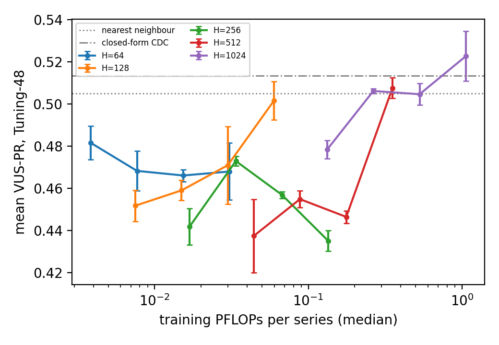

# Weekly Log: [15 Oct - 21 Oct]

## 🎯 Focus of the Week
Two strands.
1. **DG_AD (the learned geometric scorer), towards the ICML paper.**
   - Finish the first full draft.
   - Run the held-out comparisons it needs: the five baselines and extra seeds on Eva.
   - Test the open ideas left from last week.
   - Measure how small the networks can be.
2. **NP_AD (new sibling project, started 19 Oct).** Can a network map an input to its *nearest point* on the
   healthy set? This week covered the literature, the requirements, and a sequence of toy designs ending in a
   "diffusion-geometry gradient network".

Source of truth for every number: `DG_AD/docs/PROGRESS.md` and `NP_AD/docs/PROGRESS.md` (dated entries).
Some 14 Oct results came in after last week's log was written. They are reported here first.

**Protocol for every VUS-PR figure unless stated.**
- Data: TSB-AD-U. Development uses the Tuning split (48 series). The held-out Eva split (350 series) is run once on
  the frozen method.
- Metric: VUS-PR, with the benchmark's own sliding window for each series.
- Readout: the Gaussian readout, i.e. each time point's score is a Gaussian-weighted mean of the scores of the
  windows that contain it.
- Networks: seed 0 unless stated.
- A difference "A − B" is the mean of the per-series differences, with a bootstrap 95% CI.

**The method in one line** (unchanged). Two networks are trained on healthy delay windows: a denoiser $m(y)$ and a
metric network $2\Gamma$, which acts as a learned tangent projector. The score is the part of the residual
orthogonal to the healthy set, $\lVert(I-2\Gamma(m))(y-m)\rVert$. The **denoiser residual** $\lVert y-m(y)\rVert$ is
the same score without the projector.

---

## 📝 To-Do List
Carried over from last week:
- [x] Eva seeds or a caveat: seeds 1–4 were run.
- [x] Diagnose step B's divergence on the noisy sine. No single cause was found, and step B was replaced by a
  constrained objective.
- [x] Coifman–Lafon density normalisation: confirmed on toys, no effect on Tuning.
- [~] A readout that serves both short and long anomalies. The sparse projection was tried (negative). The
  readout-width and seed-averaging experiments are parked (owner, 19 Oct).
- [x] Results and theory sections of the paper. Full draft, main text 8 pages.

New this week:
- [x] Supervisors' question: Euclidean or cosine distance? Answered on Tuning.
- [x] Five pipeline baselines on Eva (main table); other metrics; readout-fairness check.
- [x] Projector error on real data: a lower bound, and where it comes from.
- [x] Paper audits: internal review, citations (40/40 real), mathematics, style, final scan.
- [x] Network size × training length grid on Tuning (2880 runs).
- [~] NP_AD: the diffusion-geometry grad net works on toys (seed 0 only).
- [ ] Choose the "smallest effective" network (owner decision; see Next Steps).

---

## 🔬 Progress & Experiments

### DG_AD

#### Carried over from 14 Oct

**Reminder of the terms.** $p^*$ is the true nearest healthy point to a query $y$.
- **Step A** (inference only) iterates two moves 20 times, starting from $m(y)$:
  - a tangent step, $x\leftarrow x+2\Gamma(x)(y-x)$;
  - a pull-back onto the set, $x\leftarrow m(x,\varepsilon_{pull})$.

  In optimisation language this is Riemannian gradient descent with the denoiser as a learned retraction.
- **Step B** trains the denoiser to output step A's answer in one pass (amortised optimisation).

**Does the pull-back matter? (toys, seed 0).**
- Without it, the tangent steps leave the curved set. At distance $d=0.4$ they end 2–6× *further* from $p^*$ than
  $m(y)$ itself.
- With a pull-back at $\varepsilon/4$, step A ends 0.009–0.013 from $p^*$ at $d=0.4$ on the noise-free shapes,
  against 0.029–0.044 for $m(y)$.
- On the set ($d=0$), no pull-back is best, because the pull-back adds its own curvature sag.

**Why step B diverges on the noisy sine.** Six runs, each changing one thing:
- clip the eigenvalues of $2\Gamma$ to [0, 1];
- halve the tangent step;
- remove the fixed-point anchor;
- keep the anchor only at small noise levels;
- build the targets at the evaluation scale;
- no change (the baseline).

Five diverged in round 1. Clipping stayed finite, but the denoiser degraded and the metric network's eigenvalues
exploded (median 117 by round 3). So none of the four candidate causes explains it alone:
- not overshoot;
- not the anchor;
- not targets built at large noise scales.

**Untested reading:** the self-referential loop amplifies errors on noisy data. The denoiser regresses onto targets
built by itself, through 20 nested applications.

**A constrained objective instead of step B (owner's design).**
- A frozen copy $m_0$ of the denoiser defines the set: $x$ is on it when $m_0(x)\approx x$.
- The trainable denoiser minimises
  $\tfrac12\lVert\mathrm{sg}[G](m_\theta(y)-y)\rVert^2+\tfrac\lambda2\lVert m_\theta(y)-m_0(m_\theta(y))\rVert^2$,
  where sg is the stop-gradient and $G=2\Gamma$. The first term is the tangent step; the second is an orthogonal
  pull onto the set.
- There is no iterated self-target and no anchor on noisy windows.

**Result** (seed 0, $\lambda=10$; $\lambda=1$ is within about 0.001). No non-finite values occurred in any run.
Distance of the output to $p^*$ at $d$ = 0 / 0.4:
- noise-free shapes: from 0.008–0.014 / 0.029–0.044 to 0.005–0.006 / 0.009–0.012;
- noisy sine: from 0.023 / 0.033 to 0.015 / 0.021.

It trains stably where step B diverged, and it is about as good as the 20-step iteration, in a single pass. Which of
the removed features mattered is not shown. It is now the training route, and NP_AD's starting point.

**Coifman–Lafon density normalisation of the denoiser** (exact kernel quantities, no training). The idea is to
divide each training window's kernel weight by its local density, $w_i\propto k_\varepsilon(y,x_i)/q_\varepsilon(x_i)^\alpha$.
With $\alpha=1$, dense regions stop pulling the barycentre towards them.
- **Toy** (circle with density $1+0.8\cos t$):
  - the tangent density pull falls from 0.0074 to 0.0008;
  - the orthogonal offset stays at the predicted curvature sag, $\varepsilon\kappa/2=0.0050$;
  - the projector evaluated at $m$ moves closer to the true one (0.032 → 0.014).

  The theory is confirmed.
- **Tuning** (45/48 series; 3 ran out of GPU memory):
  - residual +0.002 [−0.002, +0.008];
  - projected score −0.001 [−0.004, +0.002].

  No effect. At our scoring scale the density pull is small, so there is little for it to remove.

#### 15 Oct

**Euclidean vs cosine distance (supervisors' question).** For unit vectors, $\lVert u-v\rVert^2=2(1-\cos\theta)$.
So "cosine distance" is Euclidean distance after scaling each window to unit length: a change of embedding, not of
method. Tested with the nearest-neighbour baseline (distance to the closest training window), with the pipeline
otherwise unchanged.

| window representation | mean VUS-PR | − Euclidean, all 48 | long anomalies (> 2 periods, 12) | short (< 0.1 period, 11) |
|---|---|---|---|---|
| Euclidean (current: prefix z-normalisation) | **0.505** | | | |
| z-normalised per window (matrix-profile distance) | 0.419 | −0.086 [−0.202, +0.031] | −0.277 | +0.255 [−0.006, +0.537] |
| cosine (unit-length windows) | 0.374 | **−0.131 [−0.227, −0.039]** | −0.299 | −0.024 |

- Euclidean is the better choice on Tuning.
- The losses sit on anomalies of a period or longer, where level and amplitude carry the anomaly.
- Per-window z-normalisation helps spike-type anomalies; the interval just includes 0.
- This was measured with the nearest-neighbour detector, not our networks.

**Scoring scale from the data's own noise, $\varepsilon=c\,\hat\sigma^2$.** The current rule, $\varepsilon=0.64/L$,
was carried over from synthetic data and never justified on real data. Here $\hat\sigma^2$ is the median eigenvalue
of the training-window covariance, and $c\in\{3,10,30\}$ was fixed before running. Networks were retrained (144
runs). Against the current rule:

| $c$ | difference |
|---|---|
| 3 | −0.004 [−0.040, +0.043] |
| 10 | −0.047 [−0.090, −0.016] |
| 30 | −0.055 [−0.136, +0.016] |

- No value improves on the current rule.
- $c=10$ matches the current scale on the median series yet loses 0.047, so the per-series adaptation itself is
  associated with the loss.
- Two untested explanations:
  - $\hat\sigma^2$ measures leftover healthy variation, not noise;
  - the rule ignores curvature.
- The paper keeps $0.64/L$, and this test is reported as a negative result.

**Minimal-support ($\ell_1$) projection for localised anomalies.** The idea comes from Bauer's conservative
projection (review below).
- Write the window as $y=x+e$: $x$ healthy, and $e$ nonzero on as few samples as possible.
- Alternate soft-thresholding $e$ (threshold $3\hat\sigma$) with denoising $y-e$, 10 times. No retraining.
- Known-answer check: on 560_YAHOO (one labelled point), $e$ peaks exactly at the labelled sample.

Results:
- On short anomalies it beats the Gaussian readout (+0.18 [+0.006, +0.400]). It is below last week's point-by-point
  readout there (−0.051 [−0.124, −0.002]).
- It is clearly worse on medium and long anomalies.
- Partial diagnosis: the threshold is below the denoiser's own error, so $e$ absorbs model error. On 560_YAHOO, 34%
  of the entries are nonzero although one sample is anomalous.

Not adopted.

**Paper review: Bauer, "Rethinking Structural Anomaly Detection: From Decision Boundaries to Projection
Operators".** This is the closest conceptual work found: on images, a learned correcting map whose fixed points are
the normal samples, scored by its projection residual. It differs from ours in three ways:
- its projection is conservative (minimal changed pixels), not nearest-point;
- it is trained by inpainting synthetic corruptions;
- it has no tangent projector and no bound against the true distance.

Its stated future work (iterative refinement, idempotency) matches our steps A/B. The Related Work section was
corrected.

**Citation audit.** All 40 cited works are real. Sentences were corrected where a citation did not support the claim
as written, about 20 bibliography fields were fixed, and 7 entries were added.

#### 16 Oct

**How large is the projector error $g$ on real data?** In the paper's error bound,
$\lvert s-d\rvert\le a+g\lVert r\rVert$, $g=\lVert2\Gamma(m)-P\rVert$ is the metric network's projector error. The
detection-margin guarantee needs $g<1$, and it weakens as $(1+g)/(1-g)$. On real data the true projector $P$ is
unknown, but Weyl's inequality gives a lower bound: $g\ge\max_i\mathrm{dist}(\lambda_i(2\Gamma),\{0,1\})$.
- Per-series median on training windows: **0.40 [IQR 0.32, 0.46]**, against true $g$ of 0.04–0.11 on the toys
  (same architecture).
- On 43/48 series the real-data *lower bound* on the median already exceeds the largest toy median.
- On 5 series $g>1$ on the training windows themselves, so the margin guarantee is vacuous there.
- The bound is driven by intermediate eigenvalues: a median of 4 per window in [0.1, 0.9], i.e. directions neither
  clearly tangent nor clearly normal.

**Are those eigenvalues in the target or in the network?** The network's $2\Gamma$ was compared with the closed-form
(kernel) estimate of the same target, on the same windows (45/48 series).
- On 34 series the two agree (paired median difference in the bound +0.003). The intermediate eigenvalues are in the
  *target* at our scoring scale, so better training would not remove them.
- On 9 series the kernel estimate collapses: the scoring scale is small next to the spacing of the noisy training
  windows, and the network extrapolates.

**The five pipeline baselines on Eva-350 (main table; settings frozen 12 Oct, nothing tuned).** Each row's
difference is ours (seed 0) minus that row, with a bootstrap 95% CI.

| score | mean VUS-PR | ours − row |
|---|---|---|
| ours (seed 0) | 0.594 | |
| closed-form CDC score (B4: our score, both networks replaced by exact kernel formulas) | 0.589 | +0.004 [−0.016, +0.023] |
| denoiser residual (B2) | 0.585 | +0.008 [−0.006, +0.022] |
| nearest-neighbour distance (B1) | 0.568 | **+0.025 [+0.004, +0.047]** |
| PCA residual (B3) | 0.497 | +0.097 [+0.054, +0.141] |
| forecast residual (B5) | 0.362 | +0.232 [+0.188, +0.274] |
| TimeRCD_MAFT (leaderboard leader, quoted) | 0.586 | +0.008 [−0.030, +0.047] |

- Held out, our score is above the nearest-neighbour distance (on Tuning that difference was not resolved), PCA and
  the forecast residual.
- It is not distinguishable from the denoiser residual or the closed-form score. The networks match their kernel
  target without a neighbour search, rather than improving on it.
- Against TimeRCD_MAFT the means are nearly equal, with opposite strengths by family:
  - we are ahead on UCR, SVDB, MGAB and SMD;
  - we are behind on YAHOO, TODS, OPPORTUNITY, Stock and SED.

**Cost.**
- Training on one GPU: median 74 s per series, or 1.5 PFLOPs (hardware-independent count). 1.2 EFLOPs for all 350
  series.
- Size: 21–27M parameters for both networks.
- The released Time-RCD checkpoint (the leader's base model) is 37.1M (model card, quoted), so the paper does not
  claim "lightweight" against it.

**Synthetic check against the true distance** (saved toy runs).
- Score and residual both track the true distance up to 0.3 × reach.
- The projector's measurable effect is on the healthy floor: circle 0.0057 vs 0.0078; uneven-density circle 0.0052
  vs 0.0093.

**Paper.**
- The curvature-floor proposition was removed (owner: its proof sketch was strained).
- Internal-review edits were applied.

#### Weekend jobs (17–19 Oct) and 19 Oct

**Eva seeds 1–4 of the frozen method.**
- Mean VUS-PR by seed (0–4): 0.594, 0.595, 0.595, 0.594, 0.597; s.d. 0.0014.
- The five-seed average against TimeRCD_MAFT: +0.009 [−0.031, +0.048].
- Every Table 1 difference moves by at most 0.004.
- But single series flip: 43/350 have a seed range above 0.1, and 9 above 0.5 (e.g. 536_SMAP: 0.02, 0.96, 0.03, 0.90,
  0.03).

**How the flips happen** (saved data only). The anomaly peak and the largest normal peak are near-ties, and a bad
seed has a slightly higher normal peak. Most flipping series have a single anomaly (9 of 15), many of them point anomalies scored with long windows. The
fit checks saved with each run do not predict a good seed. The seed-averaging and readout-width experiments are
parked (owner).

**Other metrics on Eva** (ours, seed 0). Each cell is ours minus that column:

| metric | ours | − nearest neighbour | − denoiser residual | − TimeRCD_MAFT |
|---|---|---|---|---|
| VUS-PR | 0.594 | +0.025 [+0.004, +0.046] | +0.008 | +0.008 [−0.031, +0.046] |
| AUC-PR | 0.558 | +0.020 [−0.002, +0.043] | −0.002 | −0.032 [−0.074, +0.010] |
| VUS-ROC | 0.895 | +0.001 | −0.004 | **−0.024 [−0.039, −0.010]** |
| AUC-ROC | 0.879 | −0.000 | −0.005 | **−0.022 [−0.039, −0.005]** |

- **The ordering depends on the metric.** We are first by mean only on VUS-PR. On both ROC metrics TimeRCD_MAFT is
  ahead, with the CI excluding 0.
- The paper reports VUS-PR only (owner decision), justified by the benchmark authors' finding that it is the most
  robust measure (Liu & Paparrizos 2024, §5.2).

**Readout fairness.** Does our Gaussian readout give any detector a generic boost? It was applied to the public
zero-shot Time-RCD's point scores. The leader itself, TimeRCD_MAFT, could not be run here.
- It *lowers* VUS-PR by 0.034 [−0.056, −0.011], with losses on short-anomaly families (YAHOO, TODS) and gains on
  long ones (SMAP).
- So our parity with the leader is not explained by the readout alone.
- It suggests our own readout may cost us on YAHOO and TODS. Untested for our score.

**Paper, 19 Oct.**
- A style pass.
- A mathematical audit by a new read-only review agent. The theorem, the corollary and the identities were checked
  numerically; one error and several overclaims were found and fixed.
- Cost reported in FLOPs.
- A final three-agent scan of style, maths and accuracy.
- A ground-up guide to §4.1 for supervisor meetings: `DG_AD/docs/paper/icml/guide_section_4_1.md`.

The draft, "Learned Tangent Geometry for Delay-Embedding Anomaly Detection", has a main text that ends on page 8
(14 pages with appendices). The title is still the owner's choice.

#### 19–21 Oct: how small can the networks be?

**Why.** Low cost is a main selling point. The frozen networks copy the original RMM paper's sphere configuration
(hidden width 1024, 4 blocks) and were never sized for this task.

**Grid.**
- Hidden width $H\in\{64,128,256,512,1024\}$ for both networks;
- training length $E\in\{375,750,1500,3000\}$ epochs;
- seeds 0–2, all 48 Tuning series: 2880 runs, none failed;
- everything else frozen.

Compared against the frozen cell (1024/3000, mean 0.523; nearest neighbour 0.505, closed-form CDC 0.514).

| $H$ \ $E$ | 375 | 750 | 1500 | 3000 |
|---|---|---|---|---|
| 64 | −0.041 | −0.054 | −0.057 | −0.055 |
| 128 | −0.071 | −0.064 | −0.052 | −0.021 [−0.077, +0.040] |
| 256 | −0.081 | −0.050 | −0.066 | −0.088 |
| 512 | −0.085 | −0.068 | −0.076 | −0.015 [−0.046, +0.013] |
| 1024 | −0.044 | −0.017 [−0.061, +0.016] | −0.018 | 0 (frozen) |

*Mean VUS-PR (Tuning-48) against median training PFLOPs per series. Error bars: s.d. of the 48-series mean over 3
seeds.*

- **No smaller cell matches the frozen network on average.** Where the CI includes 0, the lower bounds reach −0.046
  to −0.108, so this is not evidence of equivalence.
- The effect is not monotone in width or length.
- **The deficit sits in about 8 series per cell.** The other 40 are at or slightly above the frozen cell.
- Breakdowns are deterministic: the three seeds agree within a cell.
- **There is no pattern with window length $L$ or width/$L$**, and only a weak one with training-set size $n$
  (Spearman −0.17).
- There are two failure types:
  - (A) **denoiser capacity**: the residual alone collapses below a width × length threshold (235_SED,
    864_OPPORTUNITY, 825_Exathlon);
  - (B) **projector collapse with the residual intact** (012_NAB, 146_MSL, 305_UCR). Here width 64 is often fine,
    while intermediate widths break.

  Untested reading for (B): a confident but wrong projector removes the anomaly's normal component.

### NP_AD (new project, from 19 Oct)

**Question.** Train a network $f$ that maps a window to its nearest point $\pi(y)$ on the healthy set. Then
$\lVert y-f(y)\rVert$ is the distance, and $f(y)$ localises the anomaly. The key identity: for any closed set $M$,
$$\phi_M(y)=\tfrac12\lVert y\rVert^2-\tfrac12d_M^2(y)=\max_{x\in M}\bigl(\langle x,y\rangle-\tfrac12\lVert x\rVert^2\bigr)$$
is convex and $\nabla\phi_M=\pi$. The nearest-point map is the gradient of a convex function. Here $d_M$ is the
distance to $M$.

**1. Sinkhorn transport targets.** Review: Han et al., "One-Step Generative Modeling via Wasserstein Gradient Flows".
- Out of the box it does not fit: it matches distributions (mass conserved), whereas $\pi$ is a per-point map.
- The solver and a known-answer test were built. On the unit circle the normal error equals the entropic sag
  $\varepsilon\kappa/2$, as predicted.
- The tangent error is a finite-sample cost of exact mass conservation: it falls as $1/\sqrt n$ and is about 0.003
  at 4000 points.
- The full run was held (owner): requirements first.

**2. Requirements note** (derived).
- An idempotent map with a symmetric Jacobian (of constant rank) is the nearest-point map on the tube.
- No continuous map is idempotent onto a loop on all of window space (no-retraction theorem), so idempotence can only
  be asked for on a tube.
- On noisy data, "the healthy set" must be defined.

**3. Distance-first network** (a scalar network trained as $\tfrac12d^2$ with an eikonal loss).
- The original loss reproduces DG_AD's earlier failure: the score is 0.05 on the set and rises only 0.10 over a
  distance of 0.8.
- The proposed near-field fix collapsed to $\eta\equiv0$. The collapsed solution's loss is exactly 19/20, and the
  run sat at it.

**4. Reading.** Seven paper reviews, each from a full read of the PDF:
- the Wasserstein gradient-flow paper (above);
- StEik;
- HotSpot;
- reach via the convexity defect function;
- neural implicit manifolds;
- stable density ridges (SCMS);
- Gradient Networks.

An agent-run literature search was also done.

**5. Convex-gradient (softmax gradient-network) route (owner's choice).** Gradient Networks' Prop. 0.1: with tied
weights, $W^\top\sigma(Wx+b)$ is the gradient of $\psi(Wx+b)$ whenever $\sigma=\nabla\psi$. With $\psi$ =
LogSumExp, rows at the data and temperature $t=1/\varepsilon$, the network *is* the kernel (Tweedie) denoiser.
- Training with anchoring and eikonal losses moved the zero set inward, by an offset of about 0.016 whatever the
  temperature. My $1/t$ explanation was rejected, and the cause is unexplained.
- The *untrained* network at $t=800$ was the best map.

**6. Diffusion-geometry grad net (20 Oct).**
- **Design.** The potential is $\Phi=\tfrac12\lVert y\rVert^2+\varepsilon\log q_\varepsilon(y)$, with
  $q_\varepsilon=\sum_j\pi_j\mathcal N(w_j,\varepsilon I)$ a mixture with learned centres. One network gives three
  exact objects:
  - its gradient is the mixture's Tweedie denoiser;
  - its Jacobian is the CDC, $2\Gamma_\varepsilon$;
  - $-\varepsilon\log q_\varepsilon\to\tfrac12d^2$ is the distance (Varadhan).
- **Training.** Denoising score matching only: no eikonal term. An optional learned noise variance $\tau^2$ lets the
  centres deconvolve onto the clean set.
- **Richardson** ($2f_{s/2}-f_s$) cancels the $O(s)$ curvature sag and density pull at evaluation.
- **Audit before the main run.**
  - Under Adam the 1024 centres random-walked off the circle, to 0.20; the per-centre gradient signal-to-noise ratio
    is 0.14.
  - Optimiser comparison (owner asked about SOAP): SOAP behaved like Adam. A large batch was best, and SGD with
    momentum (lr $10^{-3}$, cosine decay) was best per unit of compute.
  - Calibration moved to the centres; evaluation in float64.
  - The evaluation scale is now a fixed sweep, since the spacing rule was not label-free.
- **Results** (seed 0, toys; median distance error at $d$ = 0.1 / 0.4 / 0.8).
  - Noise-free and dense: Richardson removes the sag and the density pull. Circle, $s=1/50$: normal map error
    0.010 → 0.0002. Density circle: pull slope 0.039 → 0.0015.
  - 256 learned centres match the 4000-point kernel estimate.
  - A tangent floor of 0.001–0.003 remains.
  - With noise, or sparse:

    | case | kernel estimate | learned centres + learned $\tau^2$ |
    |---|---|---|
    | dense, noise 0.02 | 0.050 / 0.014 / 0.012 | 0.021 / 0.008 / 0.007 |
    | dense, noise 0.05 | 0.100 / 0.073 / 0.053 | 0.100 / 0.047 / 0.035 |
    | sparse (200 points), noise 0.02 | 0.034 / 0.011 / 0.011 | 0.014 / 0.004 / 0.004 |
    | sparse, noise 0.05 | 0.100 / 0.056 / 0.043 | 0.050 / 0.018 / 0.010 |

  - The deconvolution is partial: the learned $\tau^2$ is about half the true value.
  - **Training failure:** every arm without a learned $\tau^2$ diverged under SGD on noisy or sparse data. The
    variance floor is what keeps training stable.
- **Slides** explaining gradient networks (Prop. 0.1) and how this design fits: `slides/gradnets_2026-10-21.pdf`
  (speaker notes in the source, `NP_AD/docs/presentations/`).

---

## 📊 Results & Insights
- **Held-out result, now on 5 seeds:** 0.594–0.597 mean VUS-PR. It is not distinguishable from the leaderboard leader
  (+0.009 [−0.031, +0.048]) and is above the nearest-neighbour distance (+0.026 [+0.008, +0.046]), PCA and
  forecasting. The seed spread of the mean is small (s.d. 0.0014), but single series can flip.
- **The learned geometry still adds little beyond the pipeline.** On Eva, our score is not distinguishable from the
  denoiser residual (+0.010 [−0.003, +0.022]) or from its closed-form kernel target (+0.005 [−0.012, +0.023]).
- **The VUS-PR parity with the leader does not hold on the other metrics.** On AUC-ROC and VUS-ROC the leader is
  ahead, with the CI excluding 0. The paper reports VUS-PR only.
- **Why the projector does so little on real data.** Its error is at least 0.3–0.5 on most series, and mostly comes
  from the target at our scoring scale rather than from training. On real series the margin guarantee explains the
  design but guarantees nothing.
- **This week's negative results** (all recorded):
  - cosine and per-window z-normalised distances;
  - the noise-based scoring scale;
  - the sparse projection;
  - Coifman–Lafon on Tuning;
  - step B on noisy data;
  - smaller networks, on average.
- **NP_AD:** on toys, a single network trained only by denoising score matching gives a nearest-point map, its CDC
  and a distance. Richardson extrapolation removes the smoothing bias, and a learned noise variance helps on noisy or
  sparse samples. Limits: one seed, isotropic noise by construction, no real data yet.

---

## ⏭️ Next Steps
- **Decisions for the meeting:**
  1. **Headline network size.** The candidates by cost:
     - 512/3000: −0.015 [−0.046, +0.013], one third of the FLOPs;
     - 1024/750: −0.017 [−0.061, +0.016], one quarter;
     - 128/3000: −0.021 [−0.077, +0.040], 1/18.

     Alternatively, first run a decoupled test (a small denoiser with the full metric network, and the reverse) to
     separate the two failure types. Proposed: 5 width pairs × 3 seeds × 48 series.
  2. **Paper title.**
  3. **NP_AD's next design:** mixture components stretched along the tangent, $\mathcal N(w_j,sI+\Gamma_j)$ (the
     CDC-FM idea). Should the tangent spread be fixed from the CDC or learned?
- **DG_AD:** finish the paper (conclusion agreed; title open). Diagnose the noise-based scale's failure by comparing
  $\hat\sigma^2$ with a difference-based noise estimate on the worst series.
- **NP_AD:** apply the learned $\tau^2$ in every arm and gradient clipping for SGD. Then run seeds 1–2 and test the
  label-free setting (projector-criterion scale + Richardson) across seeds. Then the noisy delay-embedded sine, then
  Tuning.
