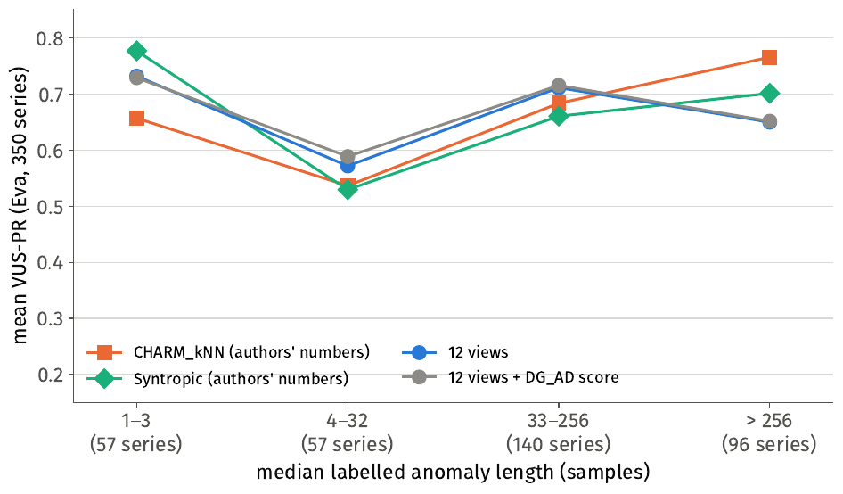
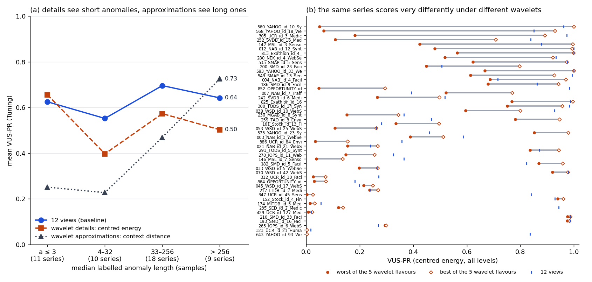
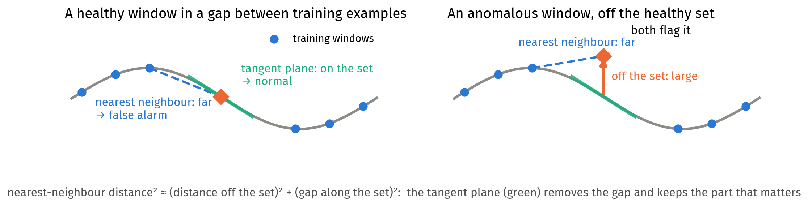
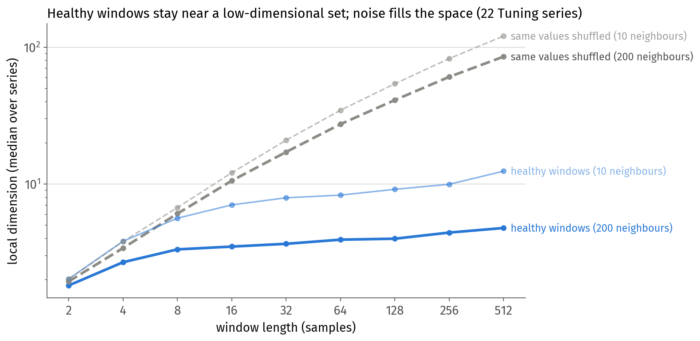
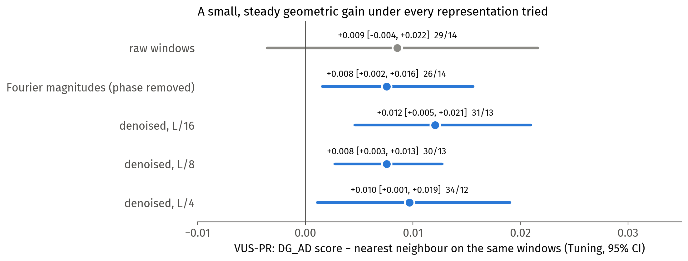
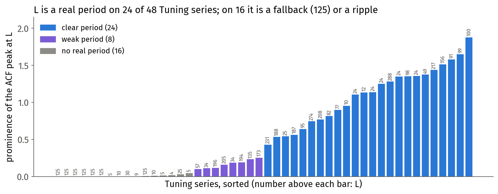
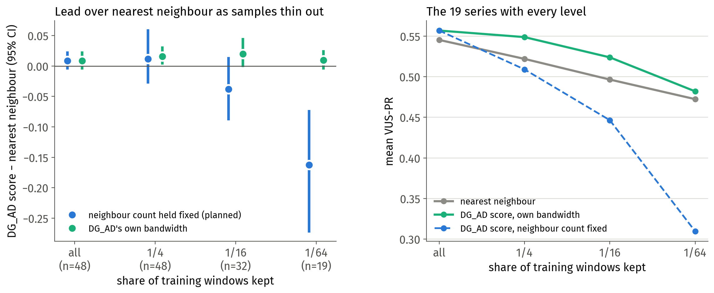
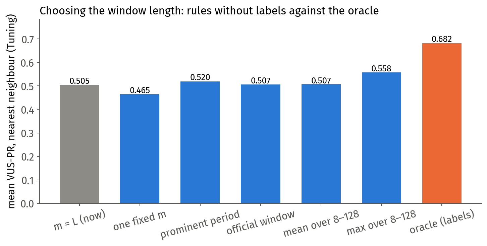
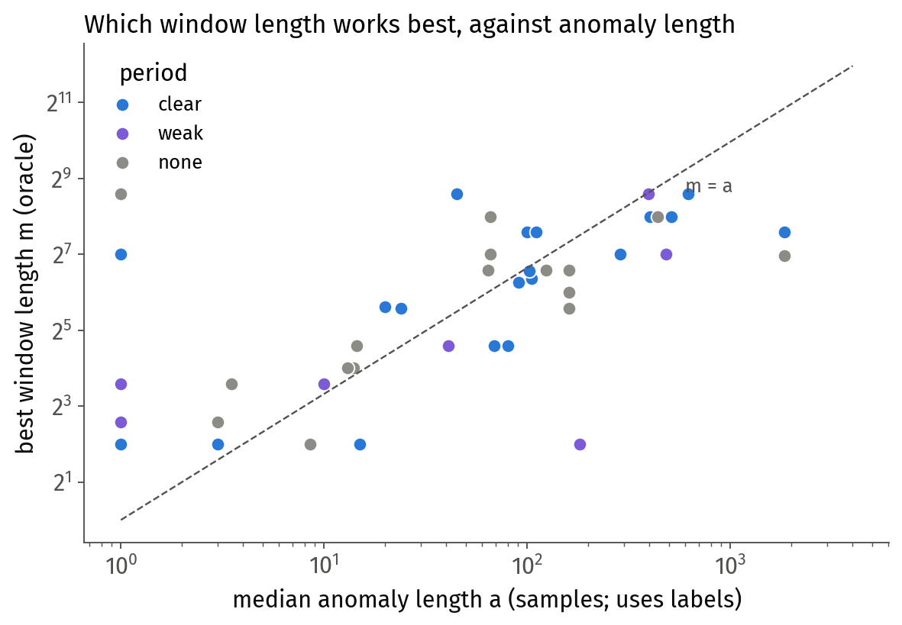

# Weekly Log: [22 Oct - 28 Oct]

## 🎯 Focus of the Week
Three strands, in the order they happened.
1. **DG_AD: where and why the learned score fails** (21–23 Oct). This was prompted by the TSB-AD leaderboard update
   of 20 Oct, which put two new entries about 0.08 VUS-PR ahead of us. It led to a training-free multi-view baseline
   (the "12 views"), a disclosed second look at the held-out split, and the owner's multi-scale / U-Net idea.
2. **Wavelets** (27–28 Oct). The owner's wavelet package `fiberad` was adopted. On 27 Oct the project was migrated to
   a clean, single-focus repository, **Wavelet_AD**. A series of diagnosis experiments (e00–e01e) asked why the wavelet
   detector falls short of the 12 views. Weekly presentation on 28 Oct.
3. **NP_AD** (21–22 Oct): segment and curved mixture pieces on toys, and a first real-data run. Paused since.

Source of truth for every number: `DG_AD/docs/PROGRESS.md` (to 27 Oct), `Wavelet_AD/docs/PROGRESS.md` (27–28 Oct)
and `NP_AD/docs/PROGRESS.md` (dated entries). Full ground-up report of the wavelet work:
`Wavelet_AD/docs/report_wavelet_experiments_2026-10-28.md`.

**Protocol for every VUS-PR figure unless stated.**
- Data: TSB-AD-U. Development uses the Tuning split (48 series). The held-out Eva split (350 series) is meant to be run
  once on a frozen method. **Eva looks used so far: 2** (7 Oct, DG_AD frozen; 22 Oct, the view ensembles, disclosed).
- Metric: VUS-PR, with the benchmark's own sliding window for each series (`find_length_rank` on the whole series).
- A difference "A − B" is the mean of the per-series differences, with a bootstrap 95% CI (10 000 resamples) and
  better/worse counts. An interval that includes 0 means "cannot tell apart", not "equal".

**Terms used throughout.**
- $L$: the period estimated from the training stretch (125 when there is none, or it is longer than 300).
- $a$: a series' median labelled anomaly length in samples. Results are binned either by $a/L$ (< 0.03, 0.03–0.1,
  0.1–0.5, 0.5–2, > 2; Tuning 7, 4, 7, 18, 12 series) or, from 27 Oct, by $a$ in samples (1–3, 4–32, 33–256, > 256;
  Tuning 11, 10, 18, 9).
- **Robust z-score**: (score − median) / IQR, over the whole series. It puts different scores on a common scale.
- **The 12 views** (defined 22 Oct, below): the mean robust z-score of 12 nearest-neighbour scores, 3 views × 4 spans.
- **DG_AD's frozen score**: $\lVert(I-G(m))(y-m(y))\rVert$, with a denoiser $m$ and a learned tangent projector $G$
  (unchanged since 7 Oct).

---

## 📝 To-Do List
Carried over from last week:
- [~] Headline network size. The width grid was analysed (21 Oct, two failure types). The decoupled test (small
  denoiser with full metric network, and the reverse) was not run. Superseded by the direction change below.
- [ ] Paper title. Not addressed this week.
- [x] NP_AD's next design: segment pieces, then curved pieces, tested on toys (21–22 Oct).
- [~] NP_AD on real data: first Tuning-48 run done (22 Oct); seeds and the label-free setting not run.

New this week:
- [x] Review the leaderboard entries of 20 Oct (CHARM_kNN, Syntropic, VERITY-AD, AxonAD).
- [x] Failure analysis of the frozen score by $a/L$; label-free readout fixes (none helped).
- [x] Representation screen → the 12-view ensemble; our score added as a 13th member; disclosed second Eva look.
- [x] Does our learned score beat nearest neighbour anywhere? (Yes on Eva, by about +0.02.)
- [x] Multi-scale: Haar ladder (stage 0), combination rules, U-Net design and stage 1; Haar slides (23 Oct).
- [x] Review and adopt the owner's `fiberad` package; method-pattern audit; migrate to Wavelet_AD.
- [x] Wavelet diagnosis e00–e01e; ground-up report; weekly slides.
- [ ] Decide the direction after e01e (owner decision; see Next Steps).

---

## 🔬 Progress & Experiments

### DG_AD

#### Carried over from 21 Oct (after last week's log)

**Which series break at smaller network sizes, and why** (saved width-grid data). Breakdowns are properties of the
configuration (the three seeds agree, median s.d. 0.012), not random failures. Two types:
- **(A) the denoiser fails** below a capacity × training threshold (235_SED, 864_OPPORTUNITY, 825_Exathlon);
- **(B) the denoiser is fine but the projected score collapses**, often at intermediate widths while width 64 is fine
  (012_NAB, 146_MSL, 305_UCR). Untested reading: a confident but wrong projector removes the anomaly.

**Leaderboard update of 20 Oct** (submitters' own numbers, not reproduced; Eva, 350 series):

| method | VUS-PR | ours − method |
|---|---|---|
| CHARM_kNN | 0.678 | −0.084 [−0.116, −0.052] |
| Syntropic | 0.669 | −0.075 [−0.113, −0.037] |
| CHARM_ZS / VERITY-AD | 0.606 | −0.012 |
| AxonAD | 0.434 | +0.160 |

Reviews (research agents; `DG_AD/docs/leaderboard/`):
- **CHARM_kNN** (C3 AI) = a nearest-neighbour score on CHARM embeddings (closed model behind an API) plus a
  nearest-neighbour score on five window statistics (std, range, max, min, mean) at window lengths 16–512.
  - The statistics half alone scores 0.600 on Eva (reference run): level with us.
  - Settings tuned on Eva ("tuned per regime on the eval split"). Training windows self-match: +0.012 on that half.
- **Syntropic** = weighted mean 2 : 1 : 0.5 of CHARM's statistics kNN (period-based lengths), a first-differences
  z-score, and the open pretrained Time-RCD model.
  - Reproduced to $2\times10^{-6}$ on all 350 Eva series. Without Time-RCD: 0.610.
  - Weights chosen after one Eva score had been seen.

#### 22 Oct: where the frozen score fails

**Failure analysis by $a/L$** (Tuning; Eva descriptive only).
- We are level with the leaders for $0.1\le a/L\le2$. The whole gap sits at the two ends.
- Four failure types, from per-series plots:
  1. dilution of short anomalies in a window of $L$;
  2. drift masking (the test part drifts away from a short training stretch);
  3. narrow response under NAB's wide label windows;
  4. genuine long anomalies are covered well.

**Label-free readout fixes** (point readout, local baselines, maxima; Tuning): none improves overall. The best,
max(Gaussian, point), is +0.008 [−0.054, +0.081]. The point readout wins the shortest class (0.77 against Syntropic's
0.66) but every combination gives back 0.02–0.14 elsewhere. Two failed fixes in a row → problem restated: the open
question is which readout a series needs, label-free.

**Prefix contamination.** Cross-fitting (each half of the training stretch scored by a network trained on the other)
gives +0.108 on the 7 series whose training stretch contains labelled anomalies, but −0.052 on the 41 clean ones.
Not a fix as it stands.

**Representation screen → the 12 views** (owner: "see if $L/4$ catches short anomalies"; nearest-neighbour score, no
training).
- **Three views of a window:** raw values; *shape* (each window rescaled to mean 0 and spread 1); first differences.
- **Four spans:** windows of $L/4$ and $L$ samples, and windows of $L$ block means over blocks of 4 and 16 samples
  ($4L$, $16L$).
- **Each member:** distance to the nearest training window (overlapping windows excluded, i.e. a Theiler window);
  Gaussian readout over the span; robust z-score.
- **The 12 views** = the plain mean of the 12 robust z-scores.

| Tuning-48 | all | < 0.03 | 0.03–0.1 | 0.1–0.5 | 0.5–2 | > 2 |
|---|---|---|---|---|---|---|
| nearest neighbour, raw windows of $L$ | 0.507 | 0.349 | 0.206 | 0.384 | 0.658 | 0.545 |
| our frozen score | 0.532 | 0.390 | 0.099 | 0.531 | 0.652 | 0.581 |
| **12 views** | **0.639** | 0.570 | 0.739 | 0.552 | 0.697 | 0.611 |

12 views − ours: +0.107 [+0.018, +0.202]. The shape view alone catches the 0.03–0.1 class (YAHOO, $L=24$), where
everything else failed.

**Our score inside the ensemble, and the disclosed second Eva look.** Our score was added as a **13th member** (robust
z, then the plain mean of 13), or put in place of the raw-$L$ member. Arms and comparisons were fixed before either run.

| | Tuning | Eva |
|---|---|---|
| 12 views | 0.639 | **0.675** |
| 12 views + our score (13 members) | 0.650 | **0.679** |
| 13 members − 12 views | +0.011 [+0.003, +0.019], 23/13 | +0.004 [−0.000, +0.009], 175/125 |
| 12 views − CHARM_kNN | — | −0.003 [−0.030, +0.025], 166/176 |
| 12 views − Syntropic | — | +0.006 [−0.022, +0.032], 187/153 |
| 12 views − our score | +0.107 | +0.081 [+0.052, +0.111] |

The training-free 12 views are level with the leaders on Eva (not shown to be equal; a deficit of up to 0.03 is not
excluded). Our learned score adds a small, consistent increment. Selection asymmetry not in our favour: CHARM tuned on
Eva; Syntropic weighted after an Eva look; ours chosen on Tuning.

*Eva, by anomaly length in samples (computed 28 Oct from the saved per-series files; leaders' numbers are their own).*
The 12 views lead on 4–256 samples and lose on anomalies longer than 256: 0.650 against CHARM_kNN 0.766 and Syntropic
0.701.

**Side studies (22 Oct), all negative or descriptive:**
- **Multi-scale readouts of one model's residual field:** no overall gain; classes trade against each other.
- **How noisy are the time steps $x_{t+1}-x_t$:** steps are mostly noise on 33/48 series (median noise share 0.84).
  In short anomalies they are about 8× the healthy size; in long ones about 1×.
- **Per-window noise level from local spacing:** removes the target collapse on sparse series, but −0.014 overall.
- **Is the metric network less accurate where we score it?** No, on dense series it is more accurate there. The
  Dino-Forcing-style retraining was therefore not run. (Paper review: `DG_AD/docs/papers/dino_forcing_…md`.)
- **One combined raw + differences distance:** recovers most of the two-view gain at one hand-picked weight, but does
  not replace two separately normalised views.
- **Diffusion-geometry toolkit review** (agent; its checks re-run and reproduced): ranked proposals, with learned
  geometry per view first.

#### 23 Oct: does the learned geometry beat nearest neighbour? And the multi-scale idea

**Learned geometry inside the first-differences and shape views:** no better than nearest neighbour in the same view
(−0.035 and −0.008); adding both learned views to the ensemble: +0.005 [−0.003, +0.014]. Two failure modes: the
projector breaks (305_UCR: top eigenvalue above 1.5 on every window), or the denoiser's residual misses what nearest
neighbour catches.

**Our score against nearest neighbour, everywhere we have both** (same raw windows):

| score − nearest neighbour | Tuning | Eva |
|---|---|---|
| closed-form kernel projector score | +0.009 [−0.004, +0.022] | **+0.021 [+0.012, +0.031]**, positive in every class |
| our network score (seed mean) | +0.016 [−0.034, +0.071] | **+0.026 [+0.007, +0.046]** |
| closed-form residual (no projector) | −0.010 | −0.003 |

- **Correction to what I told the owner:** on Eva our score does beat nearest neighbour, by about +0.02. The gain is in
  the projector (the tangent correction), and it is small.
- Rank agreement with nearest neighbour is high (median Spearman 0.86). The theory predicts a second-order correction
  on this densely covered data, and that is what is measured.

**Residual saturation:** confirmed as a property of the networks (beyond about 16× the healthy gap, the residual grows
more slowly than the distance; level shifts most). It explains a few losses (643_YAHOO, 242_SVDB), not most. Using the
nearest-neighbour distance for far windows: −0.004 [−0.031, +0.022] at best. Two fixes failed → restated: far from the
data, whether a larger score is better depends on drift vs anomaly, series by series.

**Multi-scale idea (owner): an undecimated U-Net, scoring on its skips.** Cheapest stage first.
- **Stage 0, a complete dyadic Haar ladder of nearest-neighbour members (no training):** 0.633 against the 12 views'
  0.639, −0.006 [−0.031, +0.020]. It gains +0.066 on the shortest anomalies and loses on 0.5–2. The shape view
  (−0.046 without it) and the period $L$ (−0.036 without it) both matter.
  - The pre-stated decision rule ("if it doesn't beat the 12 views, the U-Net isn't worth building") was **withdrawn**
    at the owner's objection. It was a pass/fail threshold, which project policy rules out.
- **Combination rules that cannot dilute** (maximum, per-view maximum, top 3): no better than the plain mean
  (−0.011 to −0.027). The dilution explanation is not supported.
- **U-Net stage 1** (per-series network, masking objective, levels from $L$; owner's design decisions): **0.490 against
  0.639**, −0.149 [−0.239, −0.065]. Below the fixed ladder at every level. Adding its members to the 12 views hurts
  (−0.073). A readout fix explains about a quarter of the gap. Untested remaining explanations: too little data per
  series; objective misalignment.
- **Slides:** `slides/haar_ladder_2026-10-23.pdf` (Haar theory from scratch, implementation, results). Ground-up
  report: `DG_AD/docs/report_haar_ladder_stage0_2026-10-23.md`.

#### 27 Oct: the owner's wavelet package, and the migration

- **`fiberad` review:** undecimated lifting wavelet with a ridge-fitted predictor, multiscale detail-energy detector,
  fibre heads, per-level calibration. 23/23 package tests pass. Its `run_tsbad.py` does not follow the TSB-AD protocol,
  so our harness is used instead.
- **Detail energy on Tuning:** 0.460 (maximum over levels, as designed) or 0.500 (mean over levels), against 0.639.
  Strong only on the shortest anomalies.
- **Method-pattern audit** (owner's request; `audit_method_pattern_2026-10-27.md`): six recurring patterns, e.g.
  effort spent on geometric corrections worth 0 to +0.02 while representation changes are worth about 0.1; methods
  replaced before the failing component is isolated.
- **Fibre centre ("centring"):** subtract from each detail the mean detail of the 32 training points with the most
  similar coarse context. +0.042 [+0.008, +0.082], 38/8, a small and consistent gain → **0.542**. It does not explain
  the middle-class gap.
- **Two follow-up explanations failed (edges, readout); the premise was rechecked and found wrong.** "Energy ranks
  anomalies as well as the 12 views" was an artefact of averaging over segments instead of series. Corrected in the
  log.
- **Migration to Wavelet_AD** (owner: "the project has become quite muddy"). New package `wavelet_ad/`, one-page
  `STATUS.md`, audit working rules in its `CLAUDE.md`. DG_AD stays as the archive.

### Wavelet_AD (27–28 Oct)

**The detector being diagnosed** (current wavelet score, 0.542 on Tuning):
- the fitted lifting splits the series into **details** $d_j$ (what each level's predictor misses: the U-Net's skips)
  and **approximations** $a_j$ (the series smoothed over about $2^j$ samples: the coarse path);
- per level, the centred detail energy (RMS over $2^{j+1}$ samples), standardised by the training stretch;
- mean over levels.

**e00, reproduce the baselines in the new package.** All 48 Tuning series reproduced (12 views 0.639, plain energy
0.500, centred 0.542). Found: float32 nearest-neighbour search rounds differently on CPU and GPU (VUS-PR up to
$3\times10^{-3}$) → rule: one device per experiment.

**Class-bracket check** (owner question). The $a/L$ classes are confounded: the two shortest are almost all 1–3-sample
anomalies, and $L$ is a fallback on 7 Tuning series. From now on results are also reported by $a$ in samples.

**e01, the 8 worst series** (they carry more than the whole mean deficit: −5.11 against −4.67):
- 5/8: one level (3 or 4) sees the anomaly, and the equal mean over levels buries it (305_UCR: level 3 0.948, mean
  0.181);
- 2/8: the amount of normal detail changes after training (347_UCR, 643_YAHOO);
- 1/8: a level anomaly the details cannot see (852_OPPORTUNITY).

**e01b, can a fixed set of levels fix it?** No. Levels 3–4 (the e01 pick): −0.147 [−0.234, −0.071] on the 40 series
not used to pick them. The best level varies by series. **But the wavelet as one 13th member beside the 12 views:
0.659, +0.019 [+0.003, +0.045], 28/12.**

**e01c, does the choice of wavelet matter?** No. Five undecimated wavelets with everything else fixed (centred
energy): fitted lifting 0.542, fixed lifting 0.538, starlet 0.536, Haar 0.480, symlet-4 0.484. Fitting the predictor
buys nothing. The per-series score swings by more than 0.3 across wavelets on 12/48 series (fragile).

New statistic: the **context distance**, a score on the approximations (distance from a point's coarse context to
the nearest training context).

| $a$ (samples) | details | approximations | 12 views |
|---|---|---|---|
| 1–3 | **0.656** | 0.251 | 0.625 |
| 4–32 | 0.397 | 0.227 | **0.552** |
| 33–256 | 0.573 | 0.469 | **0.696** |
| > 256 | 0.503 | **0.725** | 0.642 |

The two halves see opposite ends. The best level moves deeper as anomalies get longer: level 0 details for 1–3
samples, deep (level 4–5) approximations for > 256. Nothing sees 4–32 well.

**e01d, three no-training tests, one per suspected cause** (against the current detector):
- read both halves in one score: −0.040 [−0.115, +0.031]. It gains on long anomalies and loses more on short ones;
- standardise the series locally over $L$ (against amplitude drift): −0.202 [−0.287, −0.119]. Diagnosed: the code is
  correct; a single spike's z-score is capped at $\sqrt{n-1}$ in an $n$-sample window; and the loss is in every
  length group. So it removes the anomalies along with the drift. It did not rescue its targets either;
- a context at least one period long (for the 4–32 gap): +0.003 [−0.001, +0.007], no effect.

Two fixes failed in a row → stopped and restated: the wavelet's value is as a diverse member, not as the detector.

**e01e, the wavelet's two halves as separate members, against the simplest alternative** (a window-statistics
member: our reimplementation of CHARM_kNN's statistics half, lengths 16–512). Tuning:

| added to the 12 views | all | 1–3 | 4–32 | 33–256 | > 256 |
|---|---|---|---|---|---|
| nothing | 0.639 | 0.625 | 0.552 | 0.696 | 0.642 |
| wavelet details + approximations | 0.656 | 0.684 | 0.549 | 0.698 | 0.656 |
| **window statistics** | **0.673** | 0.627 | 0.569 | 0.739 | 0.711 |
| window statistics + wavelet | 0.675 | 0.683 | 0.569 | 0.710 | 0.714 |

- Window statistics − 12 views: **+0.033 [+0.012, +0.062], 34/8**; on > 256 samples +0.070.
- Wavelet members − window statistics: −0.017 [−0.052, +0.018]; on > 256 samples −0.056 [−0.113, −0.009].
- The wavelet adds beyond window statistics only on 1–3-sample anomalies (+0.056); overall +0.003 [−0.028, +0.034].
- **Simplest against complex: the simple member wins.** Caveats:
  - the statistics member keeps the authors' self-matching (worth +0.012 on Eva for that half; unmeasured here);
  - it is a reimplementation (running the downloaded TSB-AD file was blocked), with no known-answer check;
  - a few series carry much of the gain.

**Weekly presentation (28 Oct):** `slides/weekly_2026-10-28.pdf` (Beamer). The leaders' methods in detail, the 12
views' method and results, and how our score joins as a 13th member. The full deck with the wavelet sections is kept
as `Wavelet_AD/docs/presentations/weekly_2026-10-28_full.tex`.

#### 28 Oct (afternoon): does time-series data lie on a manifold? Geometry checks for CDC

**The supervisor's question.** Does time-series data lie on a manifold? "The sliding window causes a twisting that
fills the space." This goes to the premise of DG_AD's CDC score. That score needs healthy windows to spread along a few
(tangent) directions and be thin in the others, at the scale the method works.

**Theory, checked against the literature** (reviews in `Wavelet_AD/docs/papers/`):
- **The twisting.** Sliding a window by one sample rotates it in every frequency plane at once (Idé 2006, Eqs. 15
  and 19).
- **What a covariance can see.** The covariance of sliding windows has Fourier eigenvectors and power-spectrum
  eigenvalues whatever the data (Idé 2006, Eq. 16). So any covariance-based summary (global PCA, Hankel_AD's
  subspace) sees only the spectrum.
- **Linear against intrinsic dimension.** The twisting spreads windows over many *linear* directions without adding
  *intrinsic* ones. Intrinsic dimensions come from randomness inside a window: noise and cycle-to-cycle variation.
- **Keogh & Lin (2005).** Clustering sliding windows gives sine-wave centres for any data. Their "trivial matches"
  (a window's best matches are its own shifted copies) are what our Theiler window removes.
- **Correction.** I had credited Keogh & Lin with the shift-symmetry explanation; it is Idé's.

**Dimension check** (training stretches only, no labels).
- **Local dimension:** how many directions the healthy windows spread in around a given window. It is estimated from
  distances to the nearest windows that do not overlap in time (Levina–Bickel).
- **Reference:** the same values shuffled, which fill the space by construction.
- **Known answers:** clean sine 1.0, clean two tones 2.0.

| scale | median series | shuffled values |
|---|---|---|
| ~10 neighbours (where our methods work), window $L$ | 7.8 | 29 |
| ~200 neighbours, windows 32 → 512 samples | about 4, flat (×0.93) | grows ×4.9 |

- **At the larger scale the sliding window does not fill the space.** The windows lie near a set of about 4
  dimensions that stops growing with window length.
- **At the nearest-neighbour scale, noise dominates.** A sine with 5% noise variance reads 27 there.
- **10 of 39 series read like their shuffled values** at window length $L$: the short-period and Stock series.
- **No link** between a series' dimension and the projector's gain over nearest neighbour.

**g01: remove the phase with a Fourier transform** (owner's idea).
- **Set-up.** Windows were replaced by their Fourier magnitudes, which removes the phase and keeps the norm.
  DG_AD's score (closed form) and nearest neighbour were run on both representations.
- **Bandwidth.** The kernel bandwidth was matched to raw's effective neighbours. Removing the phase shrinks
  distances, which had made DG_AD's bandwidth average about 280 neighbours instead of about 11.

| VUS-PR (Tuning) | raw windows | Fourier magnitudes |
|---|---|---|
| nearest neighbour | 0.505 | 0.486 |
| DG_AD score | 0.514 | 0.494 |
| score − nearest neighbour | +0.009 [−0.004, +0.022] | +0.008 [+0.002, +0.016] |

- **The score's lead over nearest neighbour does not change** (difference −0.001 [−0.010, +0.009]). The phase was not
  what limited the geometry.
- **Both methods lose against raw windows** (nearest neighbour −0.019 [−0.035, −0.005]). The losses are mostly on
  anomalies a fraction of a cycle long: magnitudes discard within-cycle timing and shape.
- **Fourier windows are not cleaner locally** (12 directions against 8). On ECG they scramble the cycle: 429_UCR goes
  from 5 to 44 directions, and nearest neighbour from 0.526 to 0.249.

**g02: denoise before windowing.**
- **Set-up.** The series is smoothed by a moving average of width $L/16$, $L/8$ (primary) or $L/4$ before DG_AD's
  windows are taken. The comparison is the same as g01.

| smoothing | nearest neighbour | DG_AD score | score − nearest neighbour | local dimension ($k=10$) |
|---|---|---|---|---|
| none | 0.505 | 0.514 | +0.009 [−0.004, +0.022] | 7.9 |
| $L/16$ | 0.493 | 0.505 | +0.012 [+0.005, +0.021] | 5.4 |
| $L/8$ | 0.474 | 0.482 | +0.008 [+0.003, +0.013] | 5.1 |
| $L/4$ | 0.449 | 0.459 | +0.010 [+0.001, +0.019] | 5.0 |

- **The geometry gets cleaner, but the lead does not grow.** Change against raw at $L/8$: −0.001 [−0.012, +0.010].
- **Both methods lose more the more we smooth.** Within-cycle shape and texture are averaged away. On 429_UCR (ECG),
  nearest neighbour falls from 0.526 to 0.137 at $L/8$.
- **Two fixes failed in a row (phase removal, denoising), so the problem was restated.**
  - CDC's tangent correction is worth about +0.01 over nearest neighbour whatever the representation.
  - Theory (DG_AD 23 Oct): nearest neighbour misses the distance off the healthy set only by the gap to the nearest
    healthy sample along the set. With many repeated cycles that gap is tiny, so nearest neighbour is already nearly
    exact.
  - Noise and phase don't change that sampling density.

**$L$ audit** (owner: "have we over-assumed $L$?").
- **How $L$ is chosen.** It is TSB-AD's automatic period guess: the highest autocorrelation peak at lags 3–400, with
  125 as the fallback.
- **It is a real period on only 24 of 48 Tuning series.** On 16 it is a fallback or a ripple on a slowly changing
  series, so window lengths, smoothing widths and $a/L$ classes built on it are arbitrary there.
- **Post hoc, by group.** DG_AD's small Tuning gain sits on the series without a period (+0.028). It is −0.003 on
  clear-period series, driven by one ECG series. The groups also differ in anomaly length.

**g03: thinning the training set** (does geometry gain where samples are sparse?).
- **Set-up.** Training windows were removed at random, keeping 1/4, 1/16 or 1/64 of them, and DG_AD's score was
  compared with nearest neighbour at each level.
- **With DG_AD's own bandwidth, the lead grows a little, then falls back.** It goes +0.009 (all), **+0.016
  [+0.004, +0.030]** (1/4), **+0.020 [+0.001, +0.044]** (1/16), +0.010 (1/64). That is the shape theory predicts.
  - The change against the full set is not yet resolved: +0.007 [−0.002, +0.019] at 1/4.
- **The planned variant failed by design.** It held the number of neighbours averaged fixed, so at low density its
  bandwidth hit the search limit on up to 12 of 19 series and stopped being local: −0.163 at 1/64.

**Supervisor's direction: stick with geometry.** I wrote a short document on what geometry offers over nearest
neighbour in theory, and what our results already show, with diagrams:
`Wavelet_AD/docs/the_case_for_geometric_anomaly_detection.md`; PDF copy in this folder.

**$L$ sweep (l01).** Nearest neighbour was scored at every window length from 4 to 384 samples, per series, to find
which length works best and to work back to a rule that doesn't need labels.
- **Hindsight.** Choosing the best length per series would lift nearest neighbour from 0.505 (at $m=L$) to 0.682. This
  is an upper bound: it picks the best of about 15 values.
- **What sets the best length.** It follows the anomaly length (Spearman +0.64, about 1.2× the anomaly) much more than
  the period (+0.20).
- **A rule without labels.** The maximum over lengths 8–128 gives 0.558 (+0.053 [−0.039, +0.149]).
  - On series without a real period: 0.613 against 0.470.
  - On clear-period series, $L$ is still the best single choice.
- **Geometry by window length.** The lead is +0.024 [+0.006, +0.049] at 64 samples; there is no gain at 128–256.

### NP_AD (21–22 Oct)
- **Constrained objective ("idea 1") on toys:** large gains on noise-free and lightly noisy data, both on the set and
  inward; worse on and near the set at noise 0.05.
- **Segment pieces** (mixture of flat segments): far better than point masses on noise-free data. Fine-tuning them with
  the constrained objective failed: in 8 configurations a lower objective never reduced the far-field error. It either
  left it unchanged or moved centres off the set. Set aside.
- **Curved pieces:** with the exact tangent and curvature, the far-field error falls 7× inward and about 70× outward.
  The gain is lost to estimation error (0.8° of tangent error costs about $d\,\theta$). Under noise, where the pieces
  sit (deconvolution), not their tangents, sets the error.
- **RMM tangent errors are shared between neighbours** (a smooth field error), so neighbour smoothing cannot remove
  them.
- **First real-data run (Tuning-48):** best variant 0.489 against DG_AD's 0.532, −0.044 [−0.097, +0.001]. Its deficit
  against the closed-form kernel residual is entirely self-matching on the 7 contaminated training stretches.
- Paused since 22 Oct (work moved to multi-scale, then wavelets).

---

## 📊 Results & Insights
- **The training-free 12-view average is level with the leaderboard leaders on the held-out split** (0.675 against
  0.678 / 0.669). It beats our learned score by +0.08. Representation and diversity of views matter far more than the
  learned geometric correction.
- **The learned geometry is not wrong, just small.** On Eva the tangent projector beats plain nearest neighbour by
  about +0.02, consistently, in both closed form and network form. On top of the 12 views it adds +0.004 to +0.011.
- **Multi-scale, learned per series, loses to fixed views** (U-Net stage 1: −0.149). Fixed ladders and other
  combination rules do not beat the hand-picked 12 views.
- **Wavelets:** the scale-matching idea is real in the data: the best level moves with anomaly length. But as a single
  detector it is 0.10 below the 12 views, and not because of the choice of wavelet. Its useful parts reduce to two
  simple representations:
  - the finest detail: essentially a first difference, for 1–3-sample anomalies;
  - the deep approximation: a heavily smoothed, down-sampled window, for anomalies over 256 samples.

  For long anomalies a simpler window-statistics member does better.
- **Geometry, 28 Oct.**
  - At the scale our methods work, healthy windows are noise-dominated. The low-dimensional structure (about 4
    dimensions) shows only at coarse scales, and mainly on series with a real period.
  - Neither removing the phase nor denoising widened CDC's lead over nearest neighbour (about +0.01 every time), and
    both cost accuracy.
  - The likely reason is that many repeated cycles make nearest neighbour nearly exact.
  - $L$, our period estimate, is a real period on only half the Tuning series.
  - Thinning the training set (g03): with DG_AD's own bandwidth the lead grows a little as samples thin (+0.016 at
    1/4, +0.020 at 1/16), as theory predicts. The change is not yet resolved. Positive case written up:
    `the_case_for_geometric_anomaly_detection.pdf` (this folder).
- **Best number this week, Tuning only:** 12 views + window statistics (+ wavelet details) = 0.673–0.675. Not run on
  Eva.
- **Process:**
  - the "two failed fixes → restate" rule triggered four times (readouts, far windows, energy false alarms, e01d);
  - a decision rule was withdrawn as a pass/fail threshold;
  - one wrong premise (segment weighting) was caught and corrected.
- **Negative results recorded this week:**
  - readout fixes, cross-fitting, multi-scale readouts, per-window noise level, learned views, far-window fallback;
  - complete Haar ladder, non-diluting combinations, U-Net stage 1;
  - level subsets, wavelet flavours, both halves in one score, local standardisation, long context;
  - NP_AD segment fine-tuning.

---

## ⏭️ Next Steps
- **Decisions for the owner:**
  1. **Direction after e01e.** The evidence favours simple, diverse members (views, window statistics, first
     differences) over a wavelet or U-Net detector. Keep the wavelet only for its finest details, or drop it?
  2. **Two cheap checks before deciding** (no training, about 15 min each):
     - how much of the window-statistics gain is self-matching (rerun with a Theiler window);
     - 12 views + window statistics + wavelet details (without approximations).
  3. **Where deep learning fits, if anywhere:** a label-free learned readout or weighting over members per series
     (the fixed mean is what buries informative levels and members), rather than learned features per series, which
     lost to nearest neighbour every time this week.
  4. **When to spend the third Eva look,** on a frozen ensemble.
  5. **The CDC route on univariate windows.** On raw, phase-free and denoised windows alike, CDC is a correction of
     about +0.01 over nearest neighbour on Tuning (+0.02 on Eva, raw). One test is left that could change this: thin
     the training set and see whether the lead grows as the healthy set gets sparser.
     - If it grows, CDC's niche is short training histories.
     - If it doesn't, set the route aside for univariate windows.
  6. **$L$.**
     - Report results by period group and by $a$ in samples.
     - Fix the DG_AD paper's "our $L$ is the period".
     - The sweep suggests a rule to test: $L$ where the period is clear, a maximum over window lengths elsewhere. It
       would give about 0.561 on Tuning, but it was designed after seeing the groups, so it needs a fresh test.
- **Unexplained, worth a look before modelling:** the 10 Tuning series with 4–32-sample anomalies, which nothing of
  ours handles well (best 0.569).
- **Paper (DG_AD):** reframe around what holds. The closed-form/learned projector gives a small, consistent gain over
  nearest neighbour on Eva, and the learned score contributes as one member of a training-free ensemble. Title still
  open.
