# Weekly Log: [29 Oct – 4 Nov] — highlights

*For the meeting on Wednesday 4 Nov. Updated on 4 Nov with the work of 3–4 Nov (section 0 and the To-Do list).*
- *Each result keeps its exact numbers, its protocol and a one-line limit, so the reading stays accurate.*
- *Sources:*
  - *`SG_AD/docs/PROGRESS.md` (30 Oct – 4 Nov);*
  - *`Wavelet_AD/docs/PROGRESS.md` (29–30 Oct);*
  - *`SG_AD/docs/report_dgad_projector_score_2026-11-02.md` (the DG_AD retrospective);*
  - *the results website `SG_AD/index.html` (run `SG_AD/serve.sh`, then open `http://localhost:8000`), which has every
    picture behind section 0.*

## 🎯 Focus of the Week

1. **Wavelet_AD (29–30 Oct): the diffusion-geometry toolbox beyond the CDC.** This covered:
   - phase coordinates for timing anomalies;
   - a way to combine scales without diluting them;
   - diagnoses of what holds the views back.
2. **A change of direction (30 Oct).**
   - Leave the statistical-baseline track.
   - Build a principled, learned geometric method.
   - Find what it is good at, then choose the problem that suits it.
   - The 12 views become a reference number, not the yardstick.
3. **SG_AD, "score geometry" (30 Oct – 2 Nov).** A score model (a denoising diffusion network) is trained only on
   healthy windows and read as geometry.
   - It is tested first on synthetic data where the true geometry is known, then on TSB-AD Tuning.
   - This includes the supervisor's request to make the learned CDC work.
4. **A sharper question for SG_AD (owner, 3 Nov): "What score detects what anomaly?"** The aim is no longer one score
   with a high TSB-AD average. It is to map which score (residual, tangent-plane scores, time resolution, network reach)
   responds to which kind of anomaly, and why, shown with pictures (section 0).

---

## 📝 To-Do List

From the last meeting (28 Oct) and the requests that followed it. There are no separate meeting notes; these are the
requests recorded in the project logs.

- [x] **Supervisor: "does time-series data lie on a manifold?"** Answered on 28 Oct with geometry checks, after the
  meeting (summary in section 0.6).
- [x] **Supervisor: "stick with geometry until it works".** The project moved to SG_AD, a learned geometric method,
  on 30 Oct; the 12 views are now a reference number only.
- [~] **Supervisor: make the learned CDC work.**
  - Synthetic: done. With a 1-D CNN, RMM finds the true dimension and tangent space (section 1).
  - Real series (s12 Part B, 3 Nov): the plane is barely learned, median one direction (section 0.1).
  - The geometry learned separately at each layer (s17, 4 Nov): the planes are still thin, but per-layer tangent
    scores help long anomalies and short spikes (section 0.7).
- [~] **Owner: do anomalies of different lengths show up in the expected "layers"?**
  - Synthetic: yes (s10, s10b; section 4).
  - Tuning (s16, 4 Nov): long anomalies need a long reach, and spikes show at every reach; but there is no clean
    length-to-layer rule (section 0.5).
- [~] **Week 17's open item: the 10 Tuning series with 4–32-sample anomalies that nothing of ours handled.** s15 found
  that summing the residual over the whole window hid many short anomalies; scored at the window's centre sample, most
  of them become visible (section 0.4).
- [ ] **Paper title.** Not addressed (carried over since week 16).
- [ ] **Report results by period group and by anomaly length in samples (week 17).** Done by anomaly length and by
  cluster in s14–s16; not yet by period group.
- [ ] **Fix the DG_AD paper's "our $L$ is the period" (week 17).** Not done this week.
- [ ] **Exp and Log maps from the learned tangent space (owner, 3 Nov).** A note is written
  (`SG_AD/docs/note_exp_log_maps_2026-11-02.md`); the known-answer check has not been run.
- [ ] **When to spend the third Eva look.** Not yet: there is no frozen method to test.
- Superseded by the 30 Oct change of direction: week 17's decisions on the wavelet and 12-view ensemble, and NP_AD's
  seeds and label-free run.

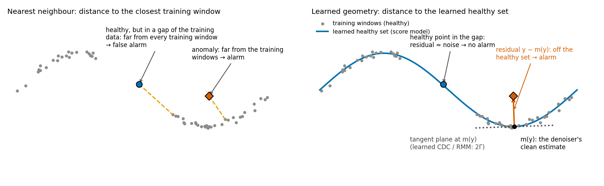

*Figure 1 (an illustration, not data).*
- *Left: the nearest-neighbour distance flags a healthy window that falls in a gap of the training data.*
- *Right: a score model learns the healthy set as one continuous object.*
  - *The same healthy window then has a small residual.*
  - *An anomaly's residual $y-m(y)$ points off the set.*
  - *The dotted line is the tangent plane at $m(y)$: what the learned CDC estimates.*

### How to read the numbers

**The data and the model.**
- **Window:** $L$ consecutive values of a series (a delay vector).
- **Healthy set:** all the windows that healthy operation can produce.
- **Score model:** a denoiser $m(y)$, trained on healthy windows with noise added.
  - $m(y)$ is roughly the nearest healthy window.
  - The residual $y-m(y)$ is the anomaly evidence.
  - The tangent space of the healthy set comes from the Jacobian of $m$, or from a learned carré du champ (RMM:
    Riemannian metric matching). This is "the learned CDC".
- **Read-out level:** the noise level the denoiser is told to remove, in units of the training noise $\sigma_n$.
  - Fine: 0.5–2 $\sigma_n$.
  - Coarse: 8–16 $\sigma_n$.
- **Synthetic testbed (s01):** healthy windows of 256 points from a five-parameter family (phase, period, amplitude,
  harmonic shape and level).
  - So the true dimension (5), the tangent space and the nearest healthy window are all known.
  - Two "holes" in amplitude and period are left out of training. Windows from the holes are **unseen but healthy**.

**Metrics.**
- **AUC:** 0.5 means invisible, or, for unseen against seen healthy windows, no false alarms. 1 is perfect.
- **VUS-PR:** TSB-AD's main metric. Higher is better.
- **Differences "A − B":** the mean of paired differences, with a bootstrap 95% CI and better/worse counts.

**Splits and baselines.**
- **TSB-AD-U Tuning:** the 48 development series.
- **Eva**, the 350 held-out series, was not run this week. Only the DG_AD retrospective (section 8) uses it, and that
  re-reads saved results.
- **Reference baselines:**
  - nearest neighbour (NN): the distance to the closest training window;
  - the 12 views: week 17's training-free NN ensemble (Tuning 0.639).

---

## ⭐ Highlights

### 0. New since the draft (3–4 Nov): which score detects which anomaly?

**How these results are measured.** All on the 48 TSB-AD Tuning series, with one model per series trained only on its
healthy training stretch.
- **Response** of a score to one labelled anomaly: log10 of the score's peak inside the anomaly over its 99th
  percentile on healthy test points far from any anomaly. +1 means 10 times above healthy; 0 means level with it.
- **Length-matched:** the peak is compared with the peaks of healthy stretches of the same length, so long anomalies
  get no free advantage. A check on 4 Nov found this changes little for the residual scores.
- The labels are used only to measure the responses, never to build the scores.
- Differences are paired, per anomaly, with bootstrap 95% intervals. Up to 10 anomalies come from one series, so these
  intervals are narrower than they should be.

#### 0.1 The learned CDC on real series (s12 Part B, 3 Nov)

- **What was tested:** RMM's tangent plane (CNN backbone, rank 32 capped at $W/2$), trained per series on top of the
  denoiser, and six tangent-plane detectors built on it.
- **Results:**
  - The off-tangent residual (DG_AD's score) against the plain residual: +0.002 [−0.021, +0.024] VUS-PR, better on 19
    series and worse on 21. No difference detected.
  - The new motion, speed and dimension scores alone: about 0.2–0.27, against 0.48 for the residual.
  - Diagnosis: the plane is barely learned. The median learned dimension is 1, and 0 on 12 series (median 466
    training windows). The known-answer sine is learned correctly (dimension 1, tangent cosine 0.999).
  - Keeping the plane's eigenvalues above 1 matters: clipping them at 1 loses 0.05–0.08.
- **Limit:** that few training windows cause the low dimension is a hypothesis, not yet tested.

#### 0.2 Why the CNN beats the MLP (s13, synthetic, 3 Nov)

- Untying the CNN's weights (same reach) made its geometry as poor as the MLP's or worse. A lower learning rate or 4
  times more steps did not close the MLP's gap.
- With 2,048 training windows, a CNN with a shorter reach learned better geometry than the full CNN on every measure
  (projector error 0.945 against 1.084).
- **Limits:** one seed, one synthetic family; untying also multiplies the parameters 165 times, so weight sharing and
  size are not separated.
- **Rank check:** a rank equal to the true dimension (5) learns the plane best. With 2,048 windows read at
  $2\sigma_n$, ranks 9–32 reach a tangent cosine of only 0.35–0.45, against 0.81 at rank 5. At $8\sigma_n$ the rank
  barely matters.

#### 0.3 A map of which score responds to which anomaly (s14, 3–4 Nov)

- **What was done:** 10 scores (the residual at four read-out levels and six tangent-plane scores) against 147
  anomalies: 144 from 45 Tuning series (up to 10 per series) and the 3 anomalies of a known-answer sine. The anomalies
  were grouped by which scores respond (Ward clustering into 6 groups; the number 6 was chosen).
- **The groups** (median responses):
  1. **25 short anomalies** (MGAB, WSD, SMD): seen by the residual, about 10 times above healthy.
  2. **15 anomalies** (from only 4 series): not seen by any score.
  3. **73 anomalies:** barely seen.
  4. **12 anomalies,** 9 of them from one series (265_IOPS): very large responses, with the plane's eigenvalues far
     above 1.
  5. **9 long anomalies:** the unclipped tangent-plane scores rise far more than the residual (off-tangent residual
     about 120 times, off-tangent motion about 2,000 times, residual 2–5 times). The clipped version falls below
     healthy in 8 of 9, so the response depends on eigenvalues above 1.
  6. **13 long anomalies:** the residual at coarse read-outs, tangential speed and the dimension score.
- **Known answers:** the sine's spike falls in group 1; its amplitude bump and 25% speed-up in group 6.
- **Limits:** 88 of 147 anomalies (groups 2 and 3) are barely seen. The groups depend on the number chosen and on the
  scores included. Cutting at 5 merges groups 2 and 3; groups 1 and 4 never change.

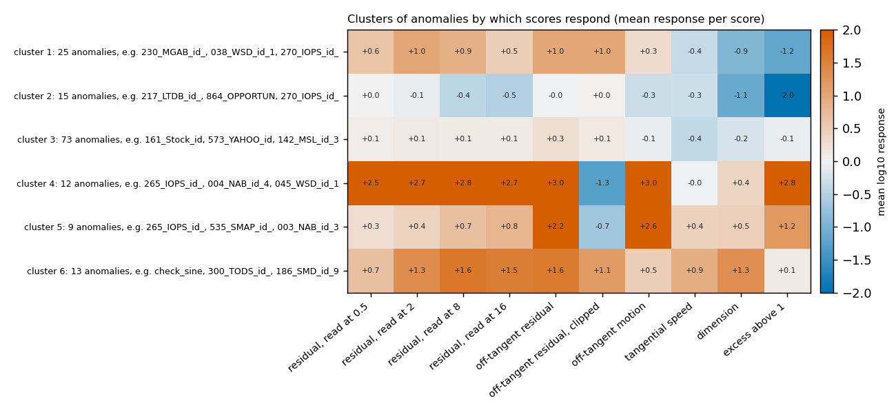

*Figure 0a. Mean response of each score (columns) in each group (rows). Red: above healthy; blue: below.*

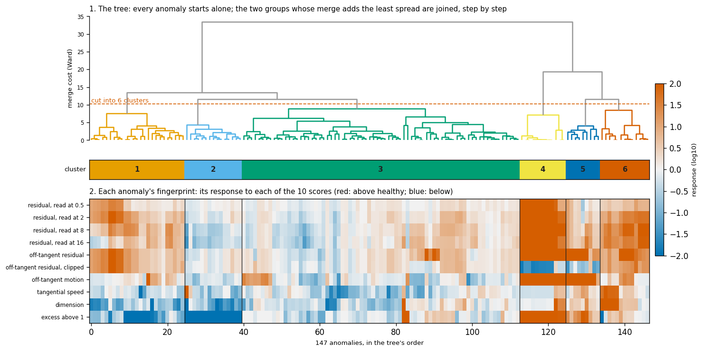

*Figure 0b. Top: the clustering tree, cut into 6 groups. Bottom: each anomaly's 10 responses, in the tree's order.*

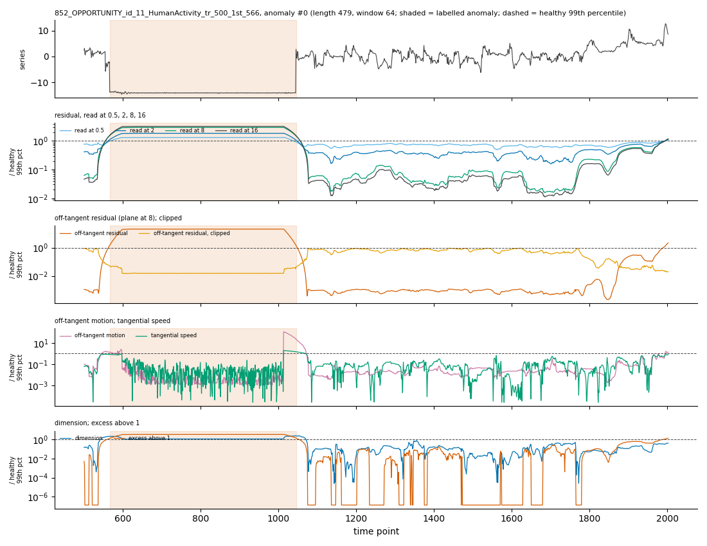

*Figure 0c. 852_OPPORTUNITY (group 5): a long drop to a flat level. The residual rises 2–3 times; the off-tangent
residual about 20 times; the clipped version falls below healthy.*

#### 0.4 The score's time resolution (s15, 4 Nov)

- **What was tested:** every s14 score adds up the residual over the whole window (32–512 samples). s15 keeps the same
  models and adds it up over only the 1, 4, 16 or 64 samples at each window's centre.
- **Results:**
  - The best number of samples follows the anomaly's length.
  - **Short anomalies appear.** Group 2: centre sample minus whole window +0.73 [+0.41, +1.04]; 8 of its 15 now rise
    more than 10 times above healthy, against none before. Spikes that are plain to the eye but were missed (070_WSD,
    560_YAHOO) are now seen.
  - **Most of group 3 does not.** On average +0.10 [−0.04, +0.25]; only its short anomalies gain.
  - **Long anomalies need long sums:** group 6 responds most to the 64-sample sum.
- **For reference:** mean VUS-PR of the centre-sample score is lower than the whole window's (0.358 against 0.482;
  −0.124 [−0.231, −0.012]); summing 16 samples is level (0.488).

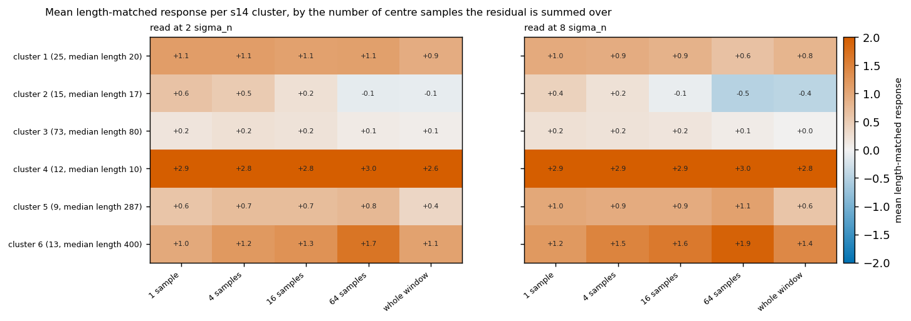

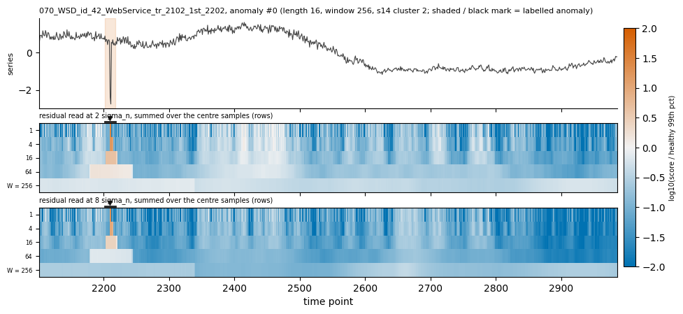

*Figure 0e. 070_WSD (group 2). Rows: the residual summed over 1, 4, 16, 64 samples and the whole window. The spike is
above healthy in the short-sum rows only.*

#### 0.5 The network's reach: one denoiser per layer (s16, 4 Nov)

- **What was tested:** one 1-D CNN per series with a denoiser after every layer, so layer $k$ sees only 5, 9, 17, …
  up to one window of samples. At $8\sigma_n$ its longest layer matches the whole-window model (−0.01 [−0.06, +0.04]),
  so the layers compare fairly.
- **Where it works:**
  - The layers show the scale at which an anomaly departs from healthy. A spike shows at every reach. A short
    localised anomaly shows once a layer sees a few times its length (group 1 rises from +0.3 at 5 samples to about +0.8
    at 129–257). Long anomalies need a long reach (group 6: +0.5 to +1.4).
  - **Known answer:** the sine's speed-up shows only once a layer sees about 2.5 periods, as s10 found on synthetic
    data.
  - **Some anomalies are seen far better than by the whole-window model:**
    - all six of 235_SED's (five of them in group 3), at +1.75 to +1.86 against +0.2 to +0.6;
    - 070_WSD's spikes;
    - one of 182_SMD's anomalies.
  - On 10 of 147 anomalies some layer beats both whole-window references by more than 0.5 (9 with at least two layers
    ahead).
- **Limits:**
  - On average group 3 stays near +0.2 at every reach. The shortest layer alone is below the whole-window model overall
    (−0.27 [−0.38, −0.16]).
  - On 235_SED every layer wins, including the longest, so that gain comes from this network, not its reach. Why is
    untested.

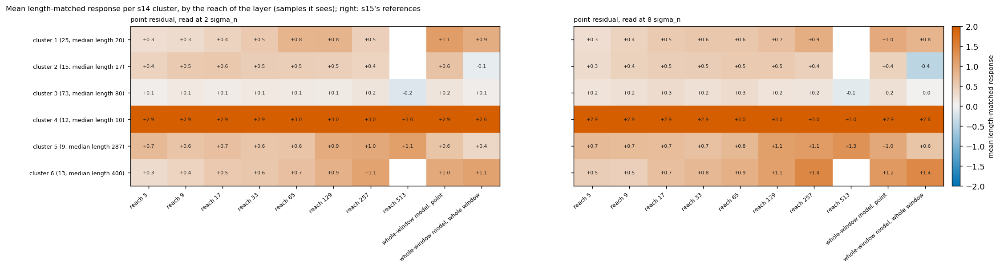

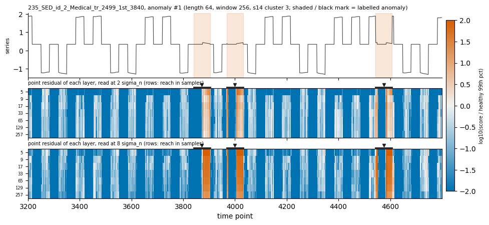

*Figure 0g. 235_SED: a step signal whose middle level is perfectly flat in healthy data. Inside each labelled stretch it
wobbles by 0.02–0.07, and every layer flags it.*

#### 0.6 Last meeting's question: does the sliding window's "twisting" fill the space? (28 Oct, after the meeting)

*The supervisor asked whether time-series data lies on a manifold, or whether "the sliding window causes a twisting
that fills the space". The full account is in week 17's log; this is the short version.*

- **What the literature says** (reviews in `Wavelet_AD/docs/papers/`):
  - **Idé (2006),** "Why Does Subsequence Time-Series Clustering Produce Sine Waves?" (PKDD). Sliding a window by one
    sample rotates it in every frequency plane at once (Eqs. 15 and 19): this is the twisting. So the covariance of
    sliding windows has sine-wave eigenvectors and the power spectrum as eigenvalues, whatever the data (Eq. 16).
    Covariance-based summaries such as PCA see only the spectrum.
  - **Keogh & Lin (2005),** "Clustering of Time Series Subsequences is Meaningless" (KAIS). Clustering sliding windows
    gives sine-wave cluster centres for almost any series. A window's best matches are its own shifted copies ("trivial
    matches").
- **What follows:** the twisting spreads the windows over many *linear* directions, but adds no *intrinsic* ones. A clean
  sine's windows trace a closed curve of dimension 1. Intrinsic dimensions come only from randomness inside a window:
  noise and cycle-to-cycle variation.
- **What we measured** (healthy training stretches, no labels):
  - Local dimension was taken from the nearest windows that do not overlap in time, which removes the trivial matches.
  - It was compared with the same values shuffled, which fill the space by construction.
  - Known answers: a clean sine reads 1.0 and two clean tones read 2.0.
- **At a larger neighbourhood scale** (about 200 neighbours), the median series' windows lie near a set of about 4
  dimensions. This stays flat as windows grow from 32 to 512 samples (×0.93); shuffled values grow ×4.9. At this scale
  the sliding window does not fill the space.
- **At the nearest-neighbour scale** (about 10 neighbours), noise dominates: 7.8 against 29 for shuffled. A sine with
  5% noise already reads 27.
- **Limits:**
  - 10 of 39 series read like their shuffled values (the short-period and Stock series).
  - There is no link between a series' dimension and how much the geometric score gains over nearest neighbour.

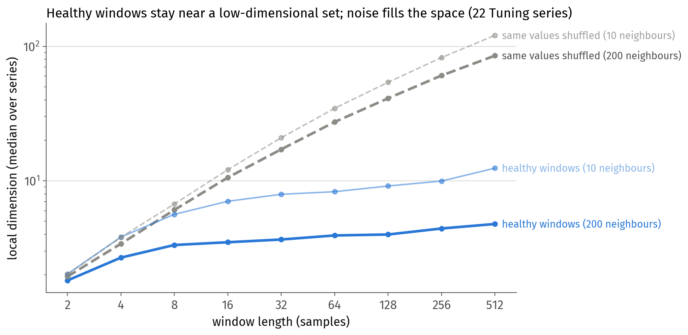

*Figure 0h (week 17). Local dimension of the healthy windows against window length, for the Tuning series and their
shuffled values.*

#### 0.7 Running now, and other work

- **Finished on 4 Nov (s17, s17a): the tangent plane learned at each layer.** Each layer's denoiser serves as RMM's
  reference, so every tangent score is computed per layer. Run on 6 GPUs, a median of 7 minutes per series.
  - **Known answers:** each metric head depends only on its own reach. The sine's one direction is found from the
    17-sample layer up, but not at 5 and 9 samples (untested reason: the read-out noise is close to the sine's
    amplitude).
  - **Where it helps** (per anomaly, one layer minus the same score on the whole window):
    - long anomalies at the 129-sample layer: group 6's tangential speed +0.38 [+0.05, +0.70] and off-tangent residual
      +0.44 [+0.15, +0.78]; group 5's off-tangent residual +0.58 [+0.11, +1.21];
    - short spikes at the 5-sample layer: group 2 +0.51 [+0.27, +0.76];
    - the sine's speed-up, which shows only from the 33-sample layer up.
  - **Limits:**
    - The planes are still thin: median dimension 1, and none on 10–26 of the 49 series depending on the layer.
    - A true projector (eigenvalues capped at 1) adds little beyond the residual (−0.02 to +0.05).
    - Group 3 stays near 0.
  - **Three tangent uses not tried before** (s17a, whole-window planes):
    - the off-tangent residual at the window's centre sample beats the whole-window version, +0.38 [+0.22, +0.55];
    - weighting along-the-set and across-the-set deviations separately helps long anomalies (+0.51 in group 6) but is
      lower overall;
    - the angle between a window's plane and the plane one period earlier is weak overall, but it is the strongest
      score on the sine's speed-up.
- **Written:**
  - a note on eleven possible uses of a tangent-space estimate for anomaly detection, four of them tested so far
    (`SG_AD/docs/note_tangent_space_uses_for_ad_2026-11-03.md`);
  - a review of *The Spacetime of Diffusion Models: An Information Geometry Perspective*
    (`SG_AD/docs/papers/`);
  - the progress log rewritten for readability, with a data pipeline and pictures for every experiment;
  - a results website with a gallery of every anomaly by group.
- **Corrections made:**
  - a gallery note that overstated one response (about 100 times; it is about 20);
  - several claims on the website corrected against the log;
  - two picture-layout bugs in the s15 figures;
  - the per-anomaly intervals' non-independence, now stated.

### 1. The learned CDC works with a 1-D CNN (s12 Part A; synthetic, known answers)

*The supervisor's request: "make it work".*

**What was tested.** An RMM network (rank 9 = $2d-1$) with SG_AD's 1-D CNN as its backbone, trained only on healthy
testbed windows. It was compared with:
- the same network on DG_AD's MLP backbone;
- the denoiser's own Jacobian.

**Results.**
- **With 16,384 training windows** it finds the true dimension (5) and the true tangent space (cosine 0.997–0.998).
  - Projector error: 0.113 at the $2\sigma_n$ read-out and 0.128 at $8\sigma_n$.
  - That is about a third of the denoiser Jacobian's error (0.316 / 0.332), the best estimate before.
- **With 2,048 windows** it learns the tangent space at the coarse read-out but not at the fine one.
  - Coarse: cosine 0.978, error 0.229 (the Jacobian's is 0.283).
  - Fine: cosine 0.349.
  - So with less data, the tangent plane is best read at a coarser level than the residual. This fits the owner's
    expectation that the projector works at its own noise level.
- **Off the set** (points moved up to four noise norms away), its largest eigenvalue stays at 1.05–1.07 wherever it
  learned the tangent space. DG_AD's MLP metric network blew up there, and does so again here (up to 10.75).

**Limits.**
- Synthetic data only.
- DG_AD's MLP backbone does not learn the tangent space at this budget (cosine 0.01–0.81). Not diagnosed yet.
- A defect in our noise correction was found while reading the results (section 10). The numbers above are after the
  fix, from re-scoring the saved models.

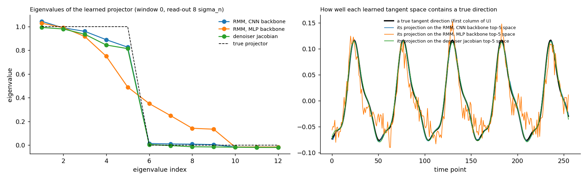

*Figure 2 (s12 Part A: one fixed window, read at $8\sigma_n$, 16,384 windows). Blue: CNN backbone; orange: MLP
backbone; green: denoiser Jacobian.*
- *Left: the eigenvalues of each learned projector. The CNN backbone has five near 1, then a clean gap, like the true
  projector (dashed).*
- *Right: a true tangent direction (black) and its projection onto each learned tangent space. The CNN backbone and
  the Jacobian track it; the MLP backbone is noisy.*

### 2. A score model learns the healthy set's geometry, and generalises where nearest neighbour cannot (s01, s09)

- **Geometry** (16,384 windows):
  - exactly 5 Jacobian eigenvalues above 0.5 (the true dimension is 5);
  - tangent cosine 0.998;
  - the clean estimate lies 0.56 noise units from the true nearest healthy window.
- **Unseen-but-healthy windows look healthy.**
  - AUC 0.53–0.57 against seen-healthy windows, close to the true projection's 0.552.
  - The nearest training window gives 0.72–0.83: it flags them (Figure 3a).
  - This is the advantage that Figure 1 illustrates.
- **The residual is localised in time.**
  - 72–97% of its energy lies inside the anomaly.
  - Cosine 0.97–1.00 with the true residual, for a spike, a glitch, a foreign cycle and an oscillation.
- **Limit:** with 256 training windows it memorises: unseen vs seen 0.66 after 20,000 steps. Early stopping at 1,000
  steps gives 0.53.

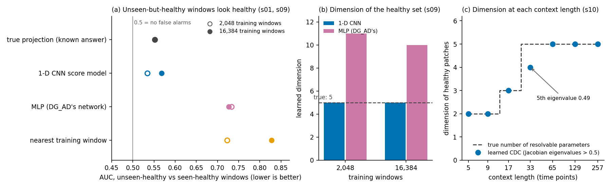

*Figure 3.*
- *(a) False alarms on unseen-but-healthy windows (0.5 = none).*
- *(b) The learned dimension of the healthy set (the true value is 5).*
- *(c) The learned dimension of healthy patches at each context length, against the true number of parameters that a
  patch of that length can resolve (section 4).*

*From SG_AD's s01, s09 and s10 summaries.*

### 3. Why the 1-D CNN: DG_AD's MLP learns this geometry less well (s09)

**The setup:** the same denoiser wrapper and training, with only the network changed (CNN, 410k parameters; MLP at
DG_AD's size, 11.1M).

**The MLP, compared with the CNN:**
- dimension 10–11 instead of 5;
- tangent cosine 0.92–0.96, against 0.98–1.00;
- 3.7 times further from the true projection at 16,384 windows;
- unseen-vs-seen AUC worse by +0.09 to +0.20, with every interval above 0.

**Why it matters:** this matches DG_AD's metric-network problems (an inflated dimension and projector error), and it is
why SG_AD uses the CNN.

**Limit:** the MLP's best learning rate lay at the edge of the grid. A size-matched MLP did not learn at all, so
convolution and size are not separated.

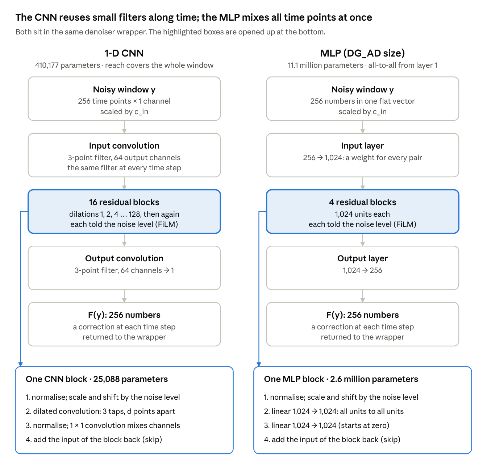

*Figure 4. The two networks, in the same denoiser wrapper.*

### 4. An anomaly's length sets the context at which it becomes visible (s10, s10b)

*The owner's question: do anomalies of different lengths show up in the expected "layers"?*

**Context models:** the same CNN, trained on healthy patches of 5 to 257 time points and read at the patch centre
(Figure 5).

**Results.**
- **The ideal estimator** (the true nearest healthy patch) sees a localised level shift (amplitude 0.4) at contexts
  about 2–4 times its length (Figure 6):
  - 8 points: from context 17–33;
  - 16 points: from 65 (AUC 0.90), and fully at 129;
  - 32 points: only at 129.
- **Speed changes** become visible at a fixed context set by the period, whatever their length: from 33–65 onwards,
  clearest at 129–257.
- **A single-point spike** is visible at every context.
- **The learned CDC per context length** finds how many healthy parameters a patch can resolve: 2, 2, 3, 4, 5, 5, 5,
  against the true 2, 2, 3, 5, 5, 5, 5 (Figure 3c).
- **The network against the ideal:** read coarsely ($16\sigma_n$, or annealed), the whole-window CNN goes 100% of the
  way to the ideal at the anomaly. At the fine read-out it goes 41%.

**Limits.**
- One synthetic family, and 20 anomaly centres per cell.
- Coarse read-outs raise false alarms on unseen-healthy windows (AUC up to 0.62).
- They also lose small anomalies (spike 0.56–0.67, against 0.75–0.81 for the ideal).
- The visual check that exposed the fine read-out's shortfall is in section 10.

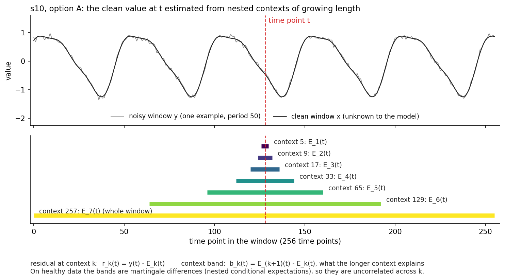

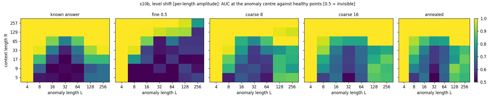

*Figure 6 (s10b: level shift, amplitude set per length). AUC at the anomaly centre against healthy points (0.5 =
invisible), by anomaly length (columns) and context (rows).*
- *Left: the ideal estimator.*
- *Right: the network at four read-outs.*

### 5. Detection on synthetic data (s02, s04, s08b)

- **One scan over place and length.** This is a single likelihood-ratio scan with one null; it neither averages nor
  maximises separate detectors.
  - VUS-PR 0.749, against 0.403 for the same scan on the nearest-window residual (noise 0.05).
  - At noise 0.2: 0.576 against 0.415.
  - AUC 0.86–1.00 on every anomaly type, including a sustained 3% speed-up.
- **Timing anomalies.** A learned model of the phase advance detects a 3% speed-up over 400 samples:
  - AUC 1.000 at noise 0.05 and 0.998 at 0.2;
  - with no false alarms from unseen healthy periods (0.483 / 0.474).

  A single healthy speed, and the toolkit's circular coordinate, both flag unseen periods (0.01–0.30).
- **Weak anomalies.** At 30% of full size, the learned residual still detects the four shape anomalies (AUC
  0.99–1.00). The nearest training window barely does (0.53–0.55).
- **Many units of one kind of system** (s08b).
  - One model shared across units of one healthy family covers healthy ranges that a unit never showed: AUC 0.512,
    against 0.977 for a per-unit model with the same amount of data.
  - Mixing in an unrelated family cost no measurable sensitivity: −0.004 to +0.009 AUC at 10% anomaly strength, with
    every interval inside [−0.016, +0.023].

**Limits.**
- The scan's single null does not hold on real series (s06).
- A learned model of the flow does not carry across unseen periods (s05; four variants tried).

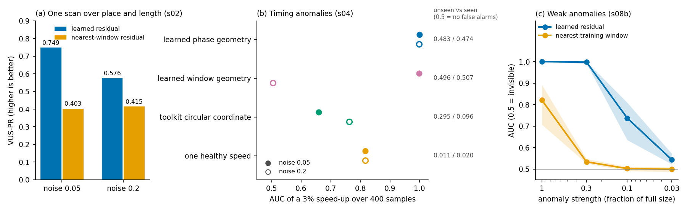

### 6. Phase coordinates see speed changes that window shape cannot (Wavelet_AD g06, g07; 29–30 Oct)

- **g06:** a phase from the toolbox's circular coordinate, on the time-step vector field. On synthetic series, phase
  minus NN at 16 periods:
  - faster by 2%: +0.404 [+0.305, +0.490] (25 better / 1 worse);
  - slower by 2%: +0.306 [+0.209, +0.388].

  A 2% speed change scores 0.15 with NN at one period, and 0.88 with the phase.
- **g07:** an untrained linear phase (the Fourier argument at the training peak).
  - It covers every series: 240/240 synthetic and 48/48 Tuning, against 211 and 39 for g06.
  - It fixes g06's failures (stall: +0.371 [+0.227, +0.518], 25/1).
  - A learned correction cuts the phase error on two-tone signals from 0.313 to 0.020 rad.
- **On Tuning,** the learned phase added to the 12 views gives +0.017 [+0.003, +0.040] (24/13).

**Limits:**
- Tuning has no timing labels.
- The learned phase loses on kinks (stall −0.211) and reacts to amplitude.

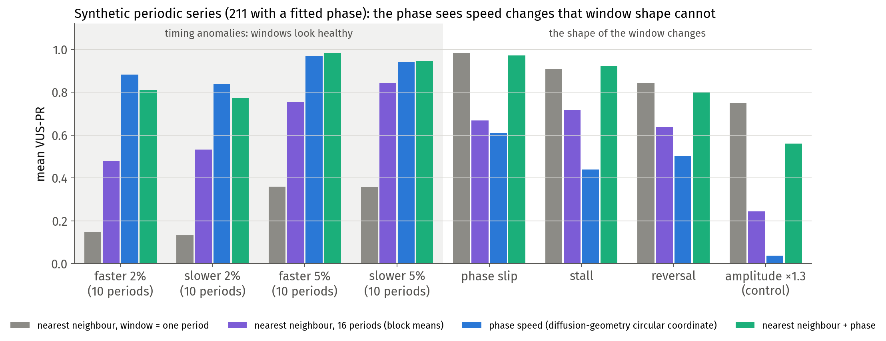

### 7. Real series (TSB-AD Tuning)

- **s02b** (per-series score models, whole-window residual).
  - With 4,000 or more training windows (19 series), the learned residual was level with or above the 12-view
    reference: 0.58 against 0.54.
  - Below that (29 series) it trails: 0.42 against 0.70. Overall: 0.484 against 0.639.
  - The split was read after the run, so it describes the results rather than tests them.
- **s11** (networks × read-out levels, all 48 series; finished 2 Nov).
  - It reproduces s02b: 0.490 against 0.484.
  - **The CNN beats DG_AD's MLP on real series, at every read-out.**
    - At the same read-out the CNN is ahead by +0.088 [+0.035, +0.151], and every MLP setting is below it.
    - The synthetic finding of section 3 carries over to detection.
  - Read-outs at 2, 8 and $16\sigma_n$ cannot be told apart on average (0.484–0.490). The finest ($0.5\sigma_n$) and the
    annealed read-outs are worse.
  - **The healthy residual is coloured:** median lag-1 autocorrelation 0.24, and above 0.5 on 17 of the 48 series. On
    real series the model leaves correlated structure in its residual, which bears on the owner's coloured-noise
    question.
  - Still below the 12-view reference: −0.149 [−0.254, −0.047].
- **Limits.**
  - On real series the learned geometry is data-limited.
  - Early stopping (s02d) did not fix this, and neither did one model shared across the 48 series (s07).
  - The white-noise estimate behind the read-out levels is unreliable on most Tuning series (section 10), so read-out
    choices on Tuning carry extra noise.

### 8. Retrospective: where DG_AD's projector score did better (Eva-350, saved results)

- **What the score is.** DG_AD's score is the residual with its tangential part removed,
  $\lVert(I-2\Gamma(m))(y-m)\rVert$. It is "detector 1" among the new tangent-plane detectors.
- **Without networks** (the closed form), removing the tangential part adds +0.024 [+0.014, +0.035] VUS-PR on the
  held-out split (better on 209 series, worse on 110).
  - The gain is positive in every anomaly-length class.
  - It is largest for anomalies 0.1–0.5 of a window long: +0.063 [+0.028, +0.111].
- **Both versions beat NN:** +0.021 [+0.011, +0.031] (closed form) and +0.026 [+0.007, +0.045] (networks, mean of 5
  seeds).
- **Where:** in both forms it helps most on MGAB, WSD, UCR and SMD. The same families show the largest gains on Tuning.
- **Limits.**
  - With networks, the gain over the residual is +0.008, not resolved.
  - The family and length breakdowns are after-the-fact subgroups.
  - Full report: `SG_AD/docs/report_dgad_projector_score_2026-11-02.md`.

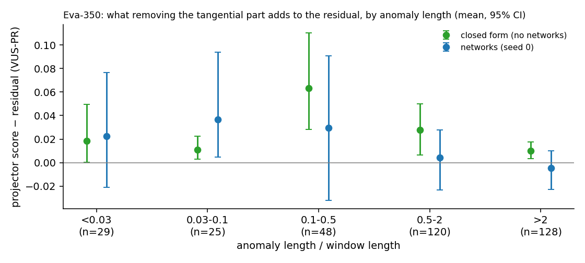

### 9. What the Wavelet_AD diagnostics settled (29–30 Oct)

- **Combining scales.** A calibrated maximum (each scale turned into a tail probability from its own training scores)
  avoids the dilution of averaging.
  - +0.155 [+0.064, +0.249] over the band mean (30/15). This is the owner's dilution argument, measured.
  - It is still below the 12 views (−0.100).
- **An exploding scale fixed.** A collapse-safe spread replaces the robust z on quantised series (535_SMAP: 0.099 →
  0.975).
  - With it, 12 views + window statistics reaches 0.681 on Tuning: +0.037 [+0.015, +0.065] over the 12 views.
  - That is the highest label-free Tuning number in the projects so far.
- **A property of VUS-PR, read from TSB-AD's code:** it rewards scores that are flat across an anomaly.
  - A score held flat inside each labelled anomaly gains +0.154 [+0.095, +0.221] (43/0).
  - This uses labels, so it is a diagnostic only.
- **Training-set contamination.** 7 Tuning series have anomalies in their training stretch.
  - Cleaning them with labels gains +0.078 [+0.012, +0.165] (6/1).
  - Trimming cannot fix it, because the contaminated windows are not outliers.
- **Sparse training data.** The first-order estimator (the distance to the flat through nearby training windows)
  removes far more distance from healthy windows than from anomalies: 0.188 against 0.031 of the squared NN distance,
  as the theory says. VUS-PR moves little.

### 10. Rigour: problems caught and fixed this week

- **Visual sanity checks are now a rule** (owner, 2 Nov). The first one paid off at once.
  - The owner saw that the fine read-out does not pull a large anomaly back to the healthy set.
  - Read coarser, the same network does: within 5% of the true projection at 8–16 $\sigma_n$.
  - This led to s10b, and to the read-out levels used in s11 and s12.
- **The noise correction in s12 was wrong for a rank-9 network:** it subtracted the noise floor in all 256 directions.
  - Arithmetic predicted the resulting error (1.757), within 0.004 of the measured 1.761.
  - Re-scoring the saved models with the fix gave the numbers in section 1.
- **A numerical overflow in the scan's chi-square tail:** cells above about 709 became infinite.
  - Fixed with a continued fraction, checked against 40-digit arithmetic (error $5\times10^{-16}$).
  - s02 moved from 0.759 to 0.749; its conclusions are unchanged.
- **The white-noise estimate (Donoho's MAD) was checked against a known answer.**
  - Under AR(1) noise it returns $\sigma\sqrt{1-\varphi}$, as theory predicts: 0.85 against 0.84 predicted at
    $\varphi=0.3$, and 0.32 against 0.32 at 0.9.
  - On Tuning it is broken by quantisation on 5 series. On 16 more, the finest scale is dominated by smooth signal or
    by red noise.
- **A citation was corrected against the PDF.**
  - In Li, Shen, Hsieh & He 2026, the nearest-point result is Eq. 20, in the proof of Theorem 5.2, and it holds within
    a tubular neighbourhood of the set.
  - Theorem 3.1 concerns the log-density.

### 11. A candidate application domain: machine sounds (DCASE)

- **The survey:** DCASE Task 2 (anomalous sound detection), 2020–2026.
- **Recommended edition: DCASE 2022.**
  - 7 machine types × 6 sections, with about 1,000 normal training clips per section.
  - Evaluation labels were released after the challenge.
  - The test includes domain shift in operating conditions.
- **Why it fits:** it has many units of one machine type, shifting operating conditions, and healthy variation that must
  not raise alarms. That is what s01 and s08 found learned geometry does well.
- **Limits:**
  - one label per clip, with no time labels;
  - the 2022/2023 records state two different licences.

### Documents written this week

- **SG_AD:**
  - `report_score_geometry_2026-10-30.md`: s01–s08b; what learned score geometry does well, and where it falls short;
  - `plan_s09_cnn_vs_mlp_2026-11-02.md` (with architecture figures) and `plan_s10_context_scales_2026-11-02.md`;
  - `survey_dcase_task2_2026-11-02.md`;
  - `report_dgad_projector_score_2026-11-02.md`: where DG_AD's projector score did better;
  - `note_exp_log_maps_2026-11-02.md`: Exp and Log maps from the learned tangent space (an idea, for 3 Nov).
- **Wavelet_AD (29 Oct):**
  - `reference_methods_and_theory.md`: every method, with its definition, results and failure modes;
  - `roadmap.md`: for newcomers;
  - `unexplored_avenues.md`: every untested idea, with its cheapest check;
  - two surveys: `survey_application_areas_2026-10-29.md` and `survey_sota_and_fields_2026-10-30.md`.

---

## ⏭️ Next Steps

- See week 19's plan, written after the meeting.
- **What makes group 3 hard?** Neither the score's time resolution nor the network's reach explains most of it.
  Proposed: a per-anomaly reference that detects by other means (the 12-view nearest-neighbour score), to see whether
  group 3 is detectable at all, and a look at a sample of its labels.
- **Combine time resolution and reach:** score each anomaly at the scale that suits it, rather than one fixed window.
- **Exp and Log maps from the learned tangent space:** a known-answer check, proposed and not yet run.
- **A read-out unit for real series** that does not depend on the white-noise estimate.
- **DCASE 2022,** if it is chosen as the application.

## Still open

- Real series with fewer than 4,000 training windows (29 of the 48 Tuning series).
- A null for the scan on non-stationary real series.
- Why a learned flow does not carry across unseen periods when the phase does.
- Why the MLP metric network fails (s12a).
